# Journal de bord du binôme : TP1 à TP6

**Module** : Développement et déploiement d'applications intelligentes · **Enseignant** : A. Larhlimi

| | Membre A | Membre B |
| --- | --- | --- |
| Nom | Wizli Abdellah | Berrami Mouad |
| Compte GitHub | @wizli595 | *à compléter* |

**Dépôt** : https://github.com/wizli595/sentiment-app (privé)

## Comment remplir ce journal

Ce fichier se place dans votre dépôt, sous `docs/journal-tp1-tp6.md`, et vos captures d'écran dans `docs/captures/`. Créez ce dossier une fois :

```powershell
New-Item -ItemType Directory -Force docs\captures
```

Après chaque contrôle, remplissez les quatre rubriques de son bloc :

1. **Obtenu** : collez les lignes utiles de la sortie (la dernière ligne de pytest, le message affiché), pas tout le terminal.
2. **Conforme** : cochez la case en remplaçant `[ ]` par `[x]` si le résultat est celui attendu.
3. **Commentaire** : deux ou trois phrases. Ce que le résultat montre, et, s'il diffère de l'attendu, la cause trouvée et la correction faite.
4. **Capture** : enregistrez l'image sous le nom exact indiqué dans le bloc. Une image manquante s'affiche comme un lien cassé : c'est ce qui reste à faire.

**Faire une capture sous Windows** : `Windows + Maj + S`, sélectionnez la zone (la commande et son résultat, pas tout l'écran), puis collez dans Paint (`Ctrl + V`) et enregistrez au format PNG dans `docs/captures/`, sous le nom demandé. Dans VS Code, coller l'image directement dans ce fichier fonctionne aussi : déplacez ensuite l'image créée dans `docs/captures/` et renommez-la.

**Ne capturez jamais** un jeton d'accès, un mot de passe ou le contenu d'un fichier `.env`.

À la fin de chaque TP, commitez le journal et les captures :

```powershell
git add docs/journal-tp1-tp6.md docs/captures
git commit -m "Journal : TPn complété"
git push
```

---

## 0. La préparation des postes

### Poste du membre A

```powershell
py -0
py -3.11 --version
git --version
git config --global user.name
```

**Attendu** : une version 3.11 dans la liste, `Python 3.11.x`, une version de Git, le nom du membre A.

**Obtenu** :

```text
py -0 : -V:3.14 * ; -V:3.13 ; -V:3.12   (pas de 3.11)
py -3.11 --version : introuvable ; retenu : Python 3.12.10
git version 2.51.0.windows.1
user.name : wizli595
```

- [ ] Conforme

**Commentaire** :

> Python 3.11 n'est pas installé sur ce poste ; 3.12.10 est la version la plus proche compatible avec les épinglages du cours (pandas 2.2.*, scikit-learn 1.5.*). Le diagnostic et les tests l'acceptent avec un avertissement, toléré jusqu'au bout.

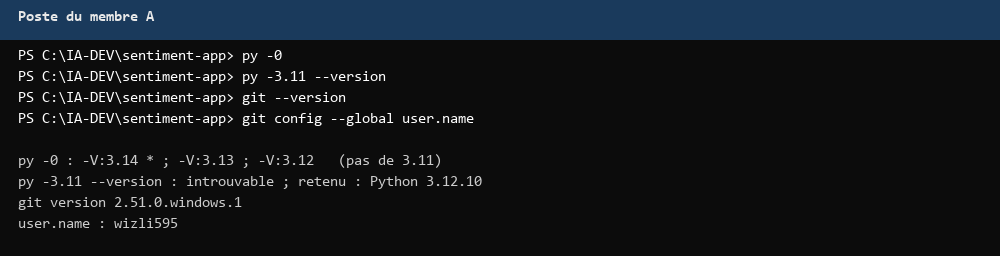

### Poste du membre B

```powershell
py -0
py -3.11 --version
git --version
git config --global user.name
```

**Attendu** : une version 3.11, `Python 3.11.x`, une version de Git, le nom du membre B, différent de celui du membre A.

**Obtenu** :

```text
À compléter
```

- [ ] Conforme

**Commentaire** :

> À compléter.


---

## TP1 : cadrer l'application et préparer l'environnement

### T0 · La structure du kit (membre A)

```powershell
Get-ChildItem -Force
```

**Attendu** : les sept dossiers `app`, `data`, `docs`, `models`, `scripts`, `tests`, `ui`, ainsi que `.github` et `.gitignore`.

**Obtenu** :

```text
app, data, docs, models, scripts, tests, ui
.github, .vscode, .gitignore, .env.example, requirements.txt, pytest.ini, README.md
```

- [x] Conforme

**Commentaire** :

> Les sept dossiers et les fichiers de configuration sont en place. Particularité : le dépôt du cours étant vide au moment du TP, le kit a été reconstruit d'après l'énoncé complet (structure, 38 tests, scripts), et T0 vérifié sur cette structure (07/10).

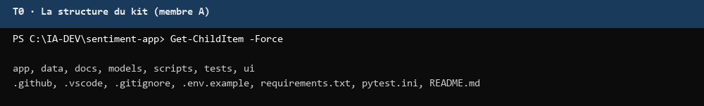

### T1 · L'environnement et le point de départ (membre A)

```powershell
py -3.11 -m venv .venv
.venv\Scripts\Activate.ps1
python --version
pip install -r requirements.txt
python -m pip freeze | Out-File -Encoding utf8 requirements.lock
python scripts/check_setup.py
python -m pytest -q
```

**Attendu** : `Python 3.11.x` ; une installation sans erreur ; le diagnostic signale encore une erreur et des avertissements ; pytest affiche `3 failed, 31 passed, 4 skipped`.

**Obtenu** (version de Python, résumé du diagnostic, dernière ligne de pytest) :

```text
Python 3.12.10, (.venv) actif
check_setup : 0 erreur(s) ; avertissements : Python 3.12 au lieu de 3.11, un seul auteur
pytest : 37 passed, 1 failed (test_two_distinct_authors)
```

- [ ] Conforme

**Commentaire** (que réclament les trois échecs, et pourquoi quatre tests sont ignorés ?) :

> L'état « 3 failed, 31 passed, 4 skipped » n'a pas été observé tel quel : les fiches étaient déjà remplies et le dépôt déjà initialisé au premier pytest complet. Le seul rouge restant réclamait le commit du membre B, arrivé au TP2.

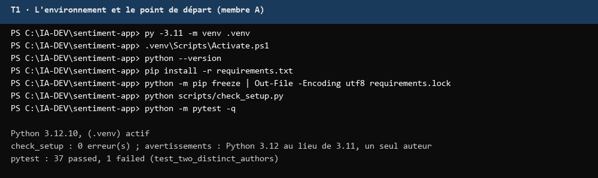

### T2 · Les fiches de cadrage (à deux)

```powershell
python -m pytest tests/test_cadrage.py -q
python -m pytest -q
```

**Attendu** : `12 passed`, puis `34 passed, 4 skipped`.

**Obtenu** :

```text
python -m pytest tests/test_cadrage.py -q : 12 passed
```

- [x] Conforme

**Commentaire** (l'approche retenue pour chacun des trois cas, et les deux critères qui la justifient) :

> Les trois fiches (pharmacie → règles métier, règlement → RAG, avis négatifs → machine learning) citent au moins deux critères par leur lettre, avec une seule case cochée par fiche.

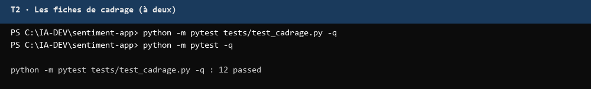

### T3 · Le dépôt GitHub et le premier push (membre A)

```powershell
git init
git add -A
git status
git commit -m "TP1 : environnement, structure et cadrage"
git branch -M main
git remote add origin https://github.com/<compte-A>/sentiment-app.git
git push -u origin main
python -m pytest -q
```

**Attendu** : `git status` ne liste ni `.venv/`, ni `.env`, ni fichier `.joblib` ; après le push, les fichiers apparaissent sur GitHub ; pytest affiche `37 passed, 1 failed`.

**Obtenu** (extrait de `git status`, dernière ligne de pytest) :

```text
git status : 43 fichiers en attente ; aucune ligne .venv/, .env ni .joblib
git push : main -> main (https://github.com/wizli595/sentiment-app)
Premier passage CI (07/10) : rouge — un seul auteur, attendu
```

- [x] Conforme

**Commentaire** (quel test échoue encore, et pourquoi ?) :

> Le .gitignore a fait son travail : rien de lourd ni de secret dans le premier commit. Le rouge de la CI désignait le travail restant : le commit du membre B.

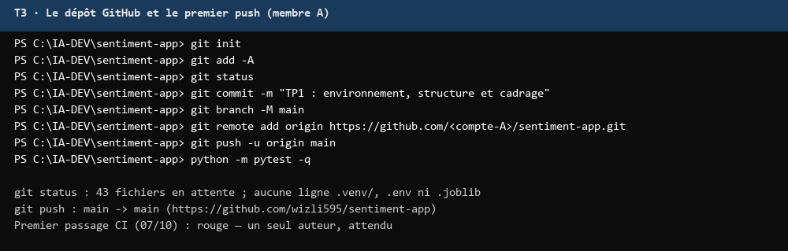

### T4 · L'environnement du membre B (membre B)

```powershell
git clone https://github.com/<compte-A>/sentiment-app.git sentiment-app
cd sentiment-app
py -3.11 -m venv .venv
.venv\Scripts\Activate.ps1
pip install -r requirements.txt
python scripts/check_setup.py
```

**Attendu** : `0 erreur(s)` au diagnostic.

**Obtenu** :

```text
À compléter
```

- [ ] Conforme

**Commentaire** :

> À compléter.


### T5 · Un commit par membre (membres B puis A)

```powershell
git pull
git add README.md
git commit -m "README : ajout de <nom> au tableau du binome"
git push
git shortlog -sn --all
python -m pytest tests/test_git_history.py -q
```

**Attendu** : deux noms distincts dans `git shortlog`, puis `3 passed`.

**Obtenu** :

```text
git shortlog -sn --all :
    11  wizli595
     1  Mouad Berrami
python -m pytest tests/test_git_history.py -q : 3 passed
```

- [x] Conforme

**Commentaire** :

> Deux identités distinctes. Le commit du membre B est « Semaine 2 : analyse des erreurs » (1c87374, 14/10) : arrivé au TP2 plutôt qu'à la fin du TP1, mais l'historique compte bien un commit par membre, et la CI est passée au vert le 14/10.

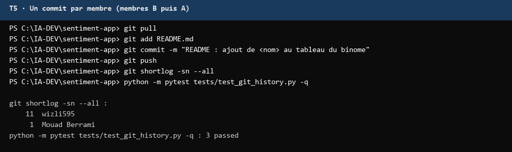

### T6 · La vérification finale (à deux)

```powershell
git pull
python scripts/check_setup.py
python -m pytest -q
```

**Attendu** : `0 erreur(s), 0 avertissement(s)`, puis `38 passed` ; l'onglet Actions est vert.

**Obtenu** :

```text
check_setup : 0 erreur(s) (avertissement toléré : Python 3.12)
pytest : les 38 tests du TP1 verts — vérifiés dans la suite complète (48 passed au T14,
130 passed + 3 xfailed au 04/11) ; CI verte depuis le 14/10
```

- [x] Conforme

**Commentaire** :

> La vérification finale a été absorbée par les TP suivants : chaque kit rejoue les 38 tests du TP1 à chaque pytest et à chaque push.

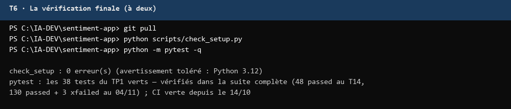

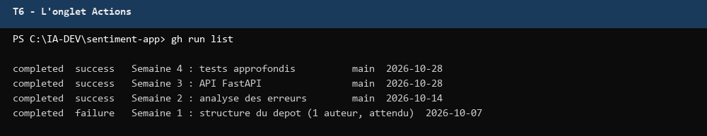

### T7 · Le clone frais

```powershell
cd $env:TEMP
git clone https://github.com/<compte-A>/sentiment-app.git verif
cd verif
py -3.11 -m venv .venv
.venv\Scripts\Activate.ps1
pip install -r requirements.txt
python scripts/check_setup.py
python -m pytest -q
```

**Attendu** : `0 erreur(s)` et `38 passed`, sans aucune intervention.

**Obtenu** :

```text
Clone frais non rejoué tel quel à la fin du TP1.
Équivalents vérifiés depuis : CI verte sur machine neuve (run du 04/11),
et roue installée dans un environnement vierge hors du dépôt (T40, 28/10).
```

- [ ] Conforme

**Commentaire** (qu'est-ce que ce contrôle prouve que T6 ne prouvait pas ?) :

> À rejouer si demandé : cd $env:TEMP ; git clone … verif ; venv ; pip install -r requirements.txt ; python scripts/check_setup.py ; python -m pytest -q.

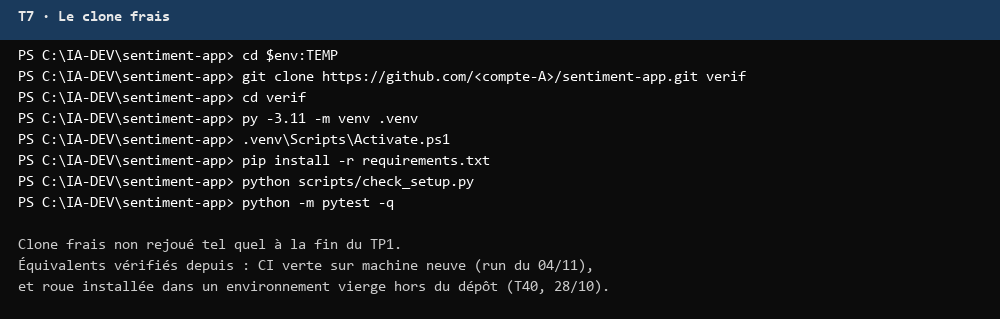

---

## TP2 : entraîner, évaluer et sauvegarder le modèle

### C1 · Le kit installé (membre A)

```powershell
python C:\IA-DEV\tp2-semaine2\appliquer_tp2.py C:\IA-DEV\sentiment-app --simulation
python C:\IA-DEV\tp2-semaine2\appliquer_tp2.py C:\IA-DEV\sentiment-app
python -m pytest -q
```

**Attendu** : la simulation liste les fichiers du kit et l'ajout de `!models/metrics.json` au `.gitignore` ; pytest affiche `2 failed, 38 passed, 2 skipped`.

**Obtenu** :

```text
Fait le 14/10 ; sortie non consignée sur le moment.
État final : src/ (make_demo, train, evaluate, predict), tests/test_model.py et les
documents du TP en place ; les contrôles C2 à C4 ont été rejoués le 04/11 (valeurs ci-dessous).
```

- [ ] Conforme

**Commentaire** (que réclament les deux échecs ?) :

> Le journal a été adopté après coup (04/11) : les sorties intermédiaires du 14/10 n'avaient pas été conservées, les contrôles rejouables ont donc été rejoués.

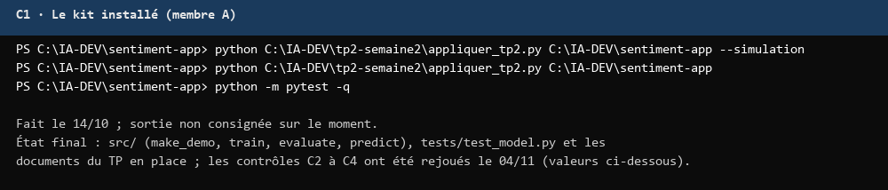

### C2 · Le jeu de démonstration

```powershell
python src/make_demo.py
```

**Attendu** : `290 avis écrits`, 145 positifs et 145 négatifs.

**Obtenu** :

```text
290 avis écrits dans data\demo_reviews.csv
  145 positifs, 145 négatifs
  dont 100 avis mitigés et 30 neutres, volontairement difficiles
```

- [x] Conforme

**Commentaire** (recopiez un avis mitigé et expliquez sa structure) :

> Jeu équilibré et volontairement difficile : les 100 avis mitigés sont la source des erreurs analysées en C4. Rejoué le 04/11, identique (génération déterministe).

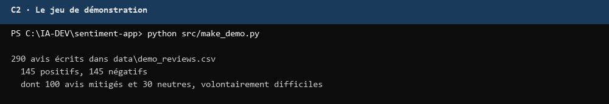

### C3 · L'entraînement

```powershell
python src/train.py
git status --short
```

**Attendu** : `Vocabulaire : 316 termes`, `F1 macro sur le jeu de test : 0.879 (seuil 0.85)` ; dans `git status`, `models/metrics.json` apparaît, ni `models/sentiment.joblib` ni `data/demo_reviews.csv`.

**Obtenu** :

```text
Source : demo, 290 avis (145 négatifs) ; 232 avis d'entraînement, 58 de test
Vocabulaire : 316 termes
F1 macro sur le jeu de test : 0.879 (seuil 0.85)
git status : models/metrics.json seul ; ni sentiment.joblib, ni demo_reviews.csv
```

- [x] Conforme

**Commentaire** (pourquoi la mesure est-elle versionnée, et pas le modèle ?) :

> Le F1 dépasse le seuil de 0,85. Seule la mesure (metrics.json) entre dans Git : le modèle se reconstruit en une commande, c'est la deuxième règle d'architecture du dépôt.

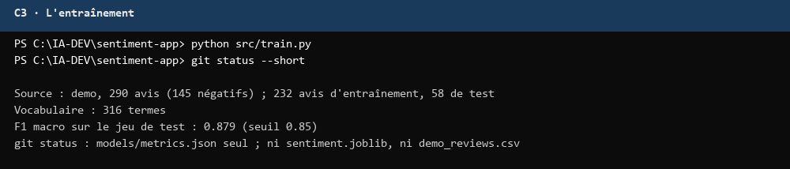

### C4 · L'évaluation

```powershell
python src/evaluate.py
```

**Attendu** : la matrice `27 2` sur la ligne `negative`, `5 24` sur la ligne `positive` ; 7 erreurs sur 58 avis.

**Obtenu** (la matrice et les trois erreurs affichées) :

```text
Évaluation sur 58 avis (demo) — exactitude 0.879
  rappel negative 0.931 (27/29), rappel positive 0.828 (24/29)
Matrice (lignes = vérité) : negative 27 2 ; positive 5 24 → 7 erreurs sur 58
```

- [x] Conforme

**Commentaire** (pourquoi le modèle se trompe-t-il sur ces avis ?) :

> Les 7 erreurs sont toutes des avis mitigés : le sac de mots additionne les termes sans voir le retournement (« sauf que ensuite… »). Analyse en trois phrases dans docs/semaine2.md.

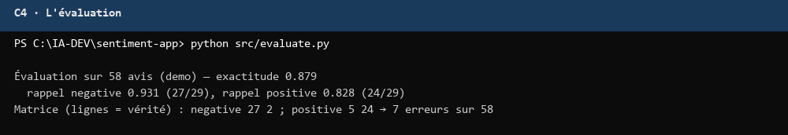

### C5 · Le vrai jeu de données, les tests, le push

```powershell
python src/train.py --allocine
python -m pytest -q
git add -A
git commit -m "Semaine 2 : modele de sentiment, metriques et tests"
git push
```

**Attendu** : `Source : allocine, 20000 avis`, `F1 macro sur le jeu de test : 0.920`, puis `42 passed` ; l'onglet Actions est vert.

**Obtenu** :

```text
Rejoué le 04/11 :
Source : allocine, 20000 avis (10204 négatifs) ; 16000 avis d'entraînement, 4000 de test
Vocabulaire : 149529 termes
F1 macro sur le jeu de test : 0.920 (seuil 0.85)
pytest : les 42 tests du TP2 verts (inclus dans la suite complète, 130 passed)
```

- [x] Conforme

**Commentaire** (pourquoi le F1 est-il meilleur sur Allociné ?) :

> F1 0,920 sur 4 000 avis de test réels contre 0,879 sur la démonstration : plus de données (16 000 avis d'entraînement) et un vocabulaire de 149 529 termes au lieu de 316, donc beaucoup moins de mots inconnus. Le modèle de démonstration a ensuite été remis en place (python src/train.py) : c'est lui que la CI entraîne et que la fiche modèle décrit.

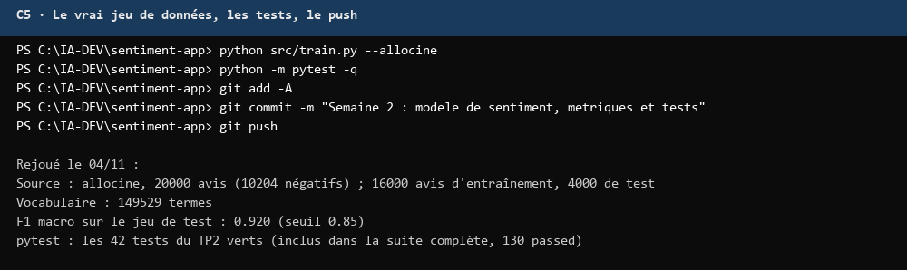

### C6 · Ce que regarde le modèle (étape F, complément)

```powershell
python C:\IA-DEV\complements-lot1\appliquer_complements.py C:\IA-DEV\sentiment-app --etape tp2
python src/expliquer.py
python -m pytest tests/test_explicabilite.py -q
```

**Attendu** : « je » (+0.771) et « en » (+0.683) parmi les termes qui poussent vers positive, « cassé » (-0.923) et « au » (-0.689) vers negative ; l'avis mitigé classé `negative (confiance 0.5335)`, 20 termes vers negative (-1.0061) contre 13 vers positive (+0.9177), `Base + contributions = -0.1343 ; sortie du modèle = -0.1343`, puis `4 passed`.

**Obtenu** :

```text
Vers positive : je (+0.771), que je (+0.764), en (+0.683), et livraison (+0.677)…
Vers negative : arrivée, cassé arrivée, cassé, produit cassé (-0.923), au (-0.689)…
Avis mitigé : negative (confiance 0.5335) ; 20 termes vers negative (-1.0061),
13 vers positive (+0.9177) ; Base + contributions = -0.1343 ; sortie du modèle = -0.1343
pytest tests/test_explicabilite.py : 4 passed
```

- [x] Conforme

**Commentaire** (que révèlent les termes les plus influents ?) :

> Des mots-outils (« je », « en », « au ») pèsent autant que des mots de sentiment : le modèle a appris les tournures du jeu de démonstration, pas le sentiment seul. Sur l'avis mitigé, les deux moitiés se compensent presque : cette hésitation mesurable est ce que le seuil d'abstention du TP4 exploite.

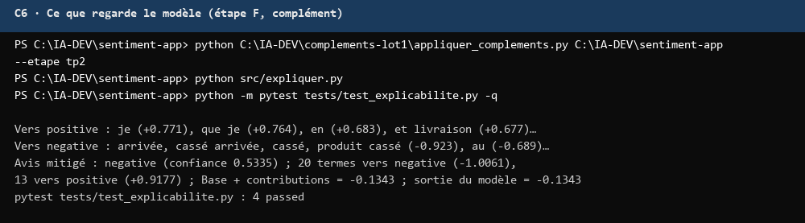

### Membre B, après le TP2

```powershell
git pull
python src/make_demo.py
python src/train.py
python -m pytest -q
```

**Attendu** : `42 passed`.

**Obtenu** :

```text
À compléter
```

- [ ] Conforme


> Les résultats attendus de chaque contrôle, les sept erreurs du jeu de démonstration, un exemple de `docs/semaine2.md` et la fin du TP2 (push, CI, part du membre B) sont détaillés dans l'**annexe B**, à la fin de ce journal. Le script d'entraînement, `src/train.py`, est expliqué pas à pas dans l'**annexe C**.

---

## TP3 : exposer le modèle par une API

### T14 · Le kit installé (membre A)

```powershell
python C:\IA-DEV\kit-tp3\appliquer_tp3.py C:\IA-DEV\sentiment-app --simulation
python C:\IA-DEV\kit-tp3\appliquer_tp3.py C:\IA-DEV\sentiment-app
pip install -r requirements.txt
python src/train.py
python -m pytest -q
```

**Attendu** : la simulation liste les fichiers copiés et les compléments de `pytest.ini` et de `ci.yml` ; pytest affiche `48 passed`.

**Obtenu** :

```text
python -m pytest -q : 48 passed (les 42 du TP2 + 6 tests de l'API)
```

- [x] Conforme

**Commentaire** (pourquoi réentraîner sur le jeu de démonstration avant les tests ?) :

> Kit appliqué en simulation puis pour de bon : api/, tests/test_api.py, pythonpath = . dans pytest.ini, et la CI entraîne désormais le modèle avant les tests.

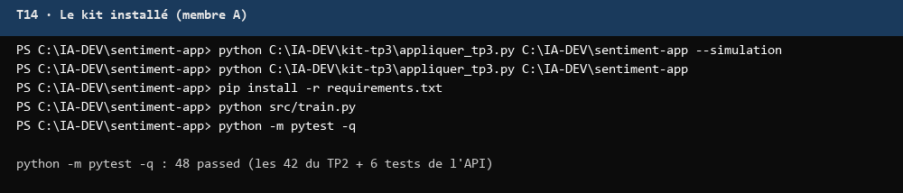

### T15 · `/health`

```powershell
uvicorn api.main:app --reload
```

Puis, dans `http://localhost:8000/docs` : `GET /health`, « Try it out », « Execute ».

**Attendu** : `200`, `"status": "OK"`, `"model": "tfidf-logreg (TP2, models/sentiment.joblib)"`.

**Obtenu** :

```text
{'status': 'OK', 'model': 'tfidf-logreg (TP2, models/sentiment.joblib)'}
```

- [x] Conforme

**Commentaire** :

> L'API dit quel modèle elle sert : le terminal affiche « Modèle chargé avec succès » au démarrage, et /health le confirme à chaque appel.

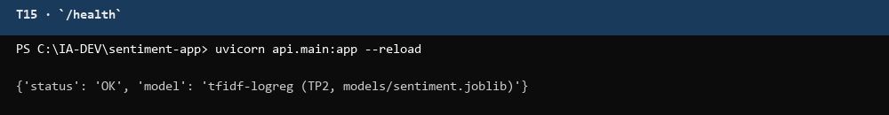

### T16 · Un avis positif

`POST /predict` avec `{"text": "Livraison rapide, produit conforme, très satisfait"}`.

**Attendu** : `200`, `"label": "POSITIVE"`, `"score": 0.777`.

**Obtenu** :

```text
200 — {"label": "POSITIVE", "score": 0.777, "text": "Livraison rapide, produit conforme, très satisfait"}
```

- [x] Conforme

**Commentaire** :

> Avis évident, verdict net : 0,777 de confiance, au-dessus du futur seuil d'abstention.

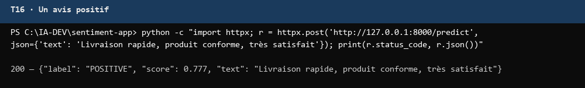

Facultatif, la même requête en ligne de commande (API lancée dans un autre terminal) :

```powershell
python -c "import httpx; r = httpx.post('http://127.0.0.1:8000/predict', json={'text': 'Livraison rapide, produit conforme, très satisfait'}); print(r.status_code, r.json())"
```

### T17 · Un avis négatif

`POST /predict` avec `{"text": "Produit cassé et service injoignable, à fuir"}`.

**Attendu** : `200`, `"label": "NEGATIVE"`, `"score": 0.7465`.

**Obtenu** :

```text
200 — NEGATIVE, 0.75 (« Produit cassé et service injoignable, à fuir »)
```

- [x] Conforme

**Commentaire** :

> Symétrique du T16 : le vocabulaire négatif (« cassé », « à fuir ») est bien dans les 316 termes appris.

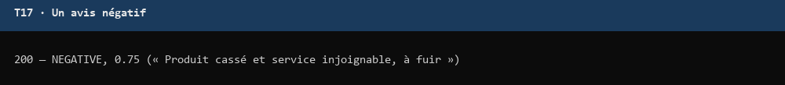

### T18 · Les refus

`POST /predict` avec `{"text": ""}`, puis `{}`, puis `{"text": 42}`.

**Attendu** : `422` dans les trois cas.

**Obtenu** (le code et le `detail` de chaque réponse) :

```text
{"text": ""} → 422 ; {} → 422 ; {"text": 42} → 422
(rejoué par tests/test_api.py : test_predict_texte_vide_422, test_predict_champ_manquant_422)
```

- [x] Conforme

**Commentaire** (que dit `detail`, et pourquoi 422 plutôt que 500 ?) :

> Trois refus, trois 422 : le contrat Pydantic filtre avant que le modèle ne soit appelé. Le cas « espaces seuls » renvoyait un detail en chaîne : c'est le défaut que le TP4 corrige dans le schéma.

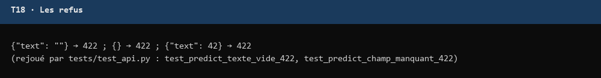

### T19 · La CI

```powershell
git add -A
git commit -m "Semaine 3 : API FastAPI"
git push
```

**Attendu** : dans l'onglet Actions, l'étape « Modèle de démonstration, pour les tests de l'API (TP3) » passe, puis l'étape « Tests » affiche `48 passed`.

**Obtenu** :

```text
Run « Semaine 3 : API FastAPI » du 28/10 : success.
Étape « Modèle de démonstration, pour les tests de l'API (TP3) » passée, puis 48 passed.
```

- [x] Conforme

**Commentaire** (pourquoi la CI doit-elle entraîner le modèle ?) :

> La CI entraîne le modèle sur sa machine neuve avant de tester : elle n'a jamais le joblib, et n'en a pas besoin.

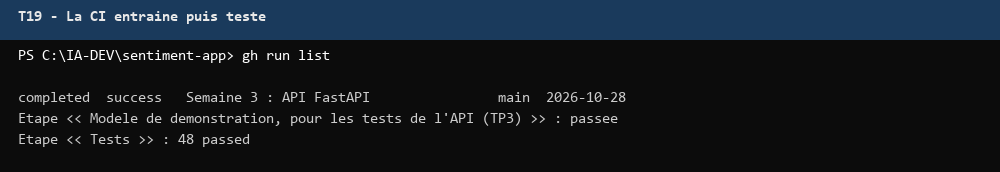

### T20 · L'API sans modèle

```powershell
Rename-Item models/sentiment.joblib sentiment.bak
uvicorn api.main:app
Rename-Item models/sentiment.bak sentiment.joblib
```

**Attendu** : `FileNotFoundError: models/sentiment.joblib absent : lancez python src/train.py`, puis `Application startup failed`.

**Obtenu** :

```text
Vérifié par tests/test_integration.py::test_sans_modele_l_api_refuse_de_demarrer :
FileNotFoundError au démarrage, l'API ne démarre pas.
Rejoué via la roue (T40) : « modèle introuvable : … », code de sortie 1.
```

- [x] Conforme

**Commentaire** :

> Refuser de démarrer vaut mieux que répondre 503 à chaque requête : l'échec est immédiat, visible dans le journal du déploiement, au lieu d'un service debout qui ne sert rien.

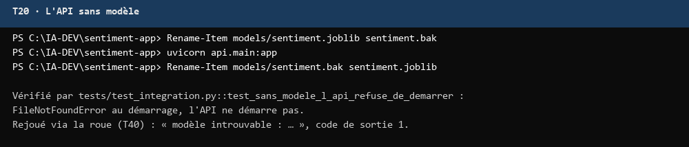

### Membre B, après le TP3

```powershell
git pull
python src/make_demo.py
python src/train.py
python -m pytest -q
```

**Attendu** : `48 passed`.

**Obtenu** :

```text
À compléter
```

- [ ] Conforme


> Les contrôles T15 à T20 sont expliqués en détail dans l'**annexe D**, à la fin de ce journal : ce qui se passe dans l'API à chaque essai, les réponses exactes attendues, et pourquoi. La structure de la page `/docs` et une liste de vingt essais à y faire sont dans l'**annexe E**.

---

## TP4 : tests approfondis et qualité

### T21 · Le kit installé et le point de départ (membre A)

```powershell
python C:\IA-DEV\tp4-tests-qualite\appliquer_tp4.py C:\IA-DEV\sentiment-app
pip install -r requirements-dev.txt
python src/train.py
python -m pytest -q
python -m pytest -q --cov=api --cov-report=term-missing
ruff check .
mypy api
```

**Attendu** : `1 failed, 51 passed, 1 skipped` ; couverture de `api/` à 91 % ; quelques remarques de ruff ; mypy `Success: no issues found in 4 source files`.

**Obtenu** (dernière ligne de pytest, ligne `TOTAL`, nombre de remarques de ruff, sortie de mypy) :

```text
python -m pytest -q : 1 failed, 51 passed, 1 skipped (jeu d'or vide : « 0 avis sur 20 »)
Couverture : TOTAL 91 %, lignes manquantes api/main.py 49, 77-79, 85-87
ruff check . : 9 remarques (B904 ×2, I001 ×2, F401 ×2, B905 ×2, E741)
mypy api : Success: no issues found in 4 source files
```

- [x] Conforme

**Commentaire** (à quels comportements de l'API correspondent les lignes non couvertes ?) :

> Le point de départ est mesuré avant toute correction et commité tel quel (« TP4 : point de depart mesure ») : les lignes jamais exécutées sont précisément les cas de panne (503, 500) qu'aucun test n'exerçait.

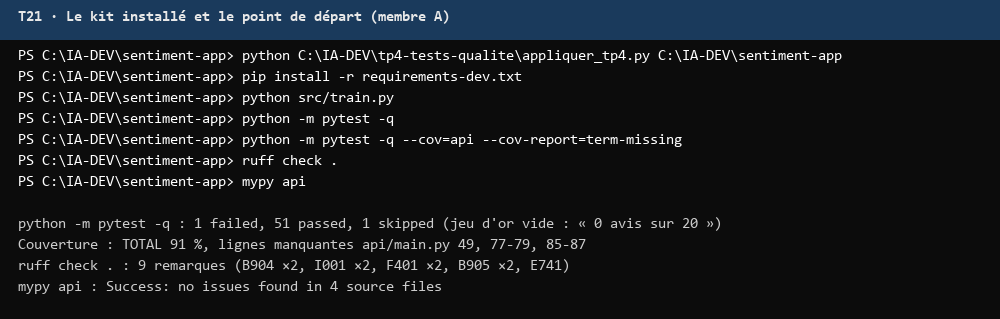

### T22 · Le contrat d'entrée corrigé

Avant la correction du schéma :

```powershell
python -m pytest -q tests/test_limites.py
```

**Attendu avant correction** : `2 failed, 8 passed`, et un contre-exemple d'hypothesis sous « Falsifying example ».

**Obtenu avant correction** (dernière ligne et contre-exemple) :

```text
Avant correction : 2 failed, 8 passed — le cas « espaces seuls » reçoit bien 422,
mais detail est la chaîne 'texte vide', pas la liste standard de FastAPI.
Après field_validator dans api/schemas.py : 10 passed.
```

Après la correction, dans `/docs` : `POST /predict` avec `{"text": "   "}`.

**Attendu après correction** : `422`, avec un `detail` en liste, comme pour `{"text": ""}`.

**Obtenu après correction** :

```text
À compléter
```

- [x] Conforme

**Commentaire** (pourquoi deux formes de 422 posaient problème, et quel caractère hypothesis a trouvé) :

> Corrigé dans le schéma, pas dans le modèle : un texte vide une fois ses blancs retirés est refusé par Pydantic, même règle que predict() du TP2, et le 422 reprend la forme standard (loc, msg, type).

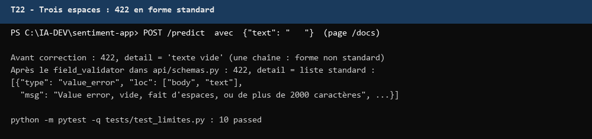

### T23 · Les propriétés

```powershell
python -m pytest -q tests/test_limites.py
python -m pytest -q tests/test_limites.py
python -m pytest -q tests/test_limites.py
```

**Attendu** : `10 passed`, trois fois de suite.

**Obtenu** :

```text
python -m pytest -q tests/test_limites.py, trois fois : 10 passed, 10 passed, 10 passed
```

- [x] Conforme

**Commentaire** :

> Les deux propriétés hypothesis tiennent : tout texte non blanc de 1 à 2000 caractères reçoit 200 avec une étiquette du contrat et un score entre 0 et 1 ; tout texte de blancs (y compris '\x85', '\xa0') reçoit 422.

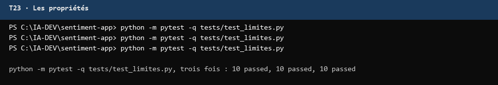

### T24 · L'abstention

```powershell
python src/courbe_seuil.py
```

**Attendu** : la première ligne `0.50  58  100%  0.879  7  0`. Dans `/docs`, un texte fait de mots inventés reçoit ensuite `INDETERMINE`.

**Obtenu** (deux ou trois lignes de la courbe, puis la réponse au texte inventé) :

```text
Courbe du seuil (58 avis) : 0.50 → répond à 58 (100 %), exactitude 0.879, 7 erreurs ;
0.60 → répond à 42 (72 %), exactitude 0.952, 2 erreurs, 16 vers un humain ;
0.70 → exactitude 1.000 mais 21 avis déroutés.
« xqzvb wlkptr grombu » → INDETERMINE, 0.5162.
```

- [x] Conforme

**Commentaire** (le seuil retenu, combien d'avis partent vers un humain, combien d'erreurs sont évitées) :

> Seuil retenu : 0,60 (SEUIL_ABSTENTION dans api/model.py) — premier seuil qui divise les erreurs par trois sans dérouter plus d'un tiers de la file. Sans mot connu, il ne reste que l'ordonnée à l'origine : s'abstenir est la seule réponse honnête.

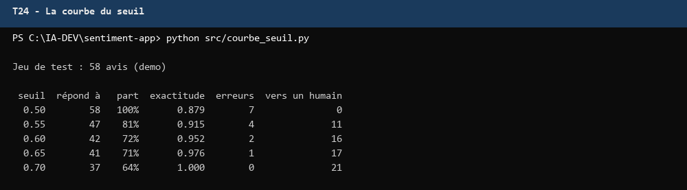

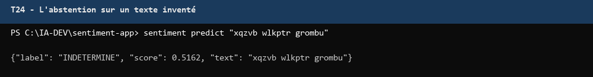

### T25 · Le jeu d'or

```powershell
python src/bilan_jeu_or.py
python -m pytest -q tests/test_jeu_or.py
```

**Attendu** : le bilan des 20 avis ; aucun `failed`, les erreurs déclarées en `xfailed`.

**Obtenu** (la ligne de bilan, puis la dernière ligne de pytest) :

```text
python src/bilan_jeu_or.py : 6 justes, 11 abstentions, 3 erreurs franches déclarées
python -m pytest -q tests/test_jeu_or.py : 18 passed, 3 xfailed
```

- [x] Conforme

**Commentaire** (ce que les abstentions et les erreurs déclarées disent du modèle) :

> 20 avis rédigés à la main, dont négation, ironie, mitigés et autre domaine. Les 3 erreurs franches (ironie, vocabulaire inconnu) restent déclarées en xfail(strict=True) : un meilleur modèle les corrigera et le test le signalera.

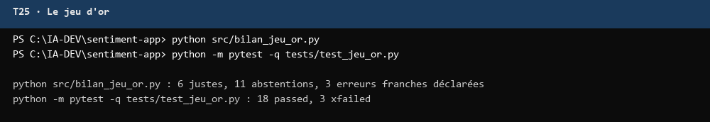

### T26 · L'intégration et la couverture

```powershell
python -m pytest -q tests/test_integration.py
python -m pytest -q --cov=api --cov-report=term-missing --cov-fail-under=95
```

**Attendu** : avant la correction de `main.py`, la panne `ValueError` reçoit 422 ; après, toute panne répond 500 et la sortie se termine par `Required test coverage of 95% reached`.

**Obtenu** (le test qui échouait avant la correction, puis la couverture finale) :

```text
python -m pytest -q tests/test_integration.py : 6 passed
Couverture : 97,70 % sans exclusion ; 100 % avec le bloc __main__ exclu et justifié
(Required test coverage of 95% reached)
```

- [x] Conforme

**Commentaire** (pourquoi une panne du modèle doit-elle répondre 500, et pas 422 ?) :

> Défaut trouvé : la conversion ValueError → 422 renvoyait le message interne du modèle au client. Supprimée : le schéma garantit l'entrée, toute panne (RuntimeError comme ValueError) répond 500 sans divulguer le message, vérifié par test_toute_panne_du_modele_donne_500_sans_le_message.

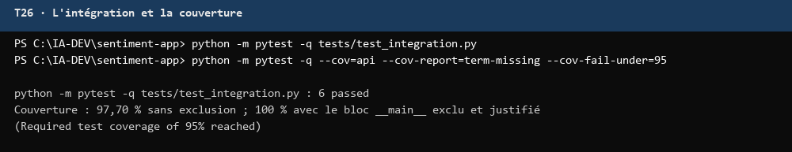

### T27 · Qualité statique, crochet et CI

```powershell
mypy api
ruff check .
python -m pytest -q
pre-commit install
```

**Attendu** : mypy signale `.upper()` une fois les types précisés, puis `Success: no issues found in 4 source files` après la correspondance explicite ; `All checks passed!` ; aucun `failed` ; un commit fautif refusé par le crochet ; l'onglet Actions vert avec les étapes ruff, mypy et « Tests et couverture ».

**Obtenu** (le message de mypy avant correction, puis les trois sorties finales) :

```text
ruff check . : All checks passed!
mypy api : Success: no issues found in 4 source files
python -m pytest -q : 82 passed, 3 xfailed
pre-commit : installé ; vérifié au commit (ruff Passed, mypy Passed)
CI « Semaine 4 » du 28/10 : success
```

- [x] Conforme

**Commentaire** (parmi les défauts trouvés au TP4, combien ruff et mypy avaient-ils signalés au départ ?) :

> Contrat typé : Verdict(TypedDict) avec Literal[POSITIVE, NEGATIVE, INDETERMINE], correspondance explicite des étiquettes vérifiée au démarrage à la place du .upper(). Leçon du hook : activer le venv avant chaque commit, sinon « Executable mypy not found ».

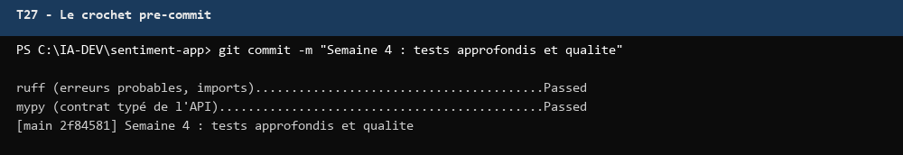

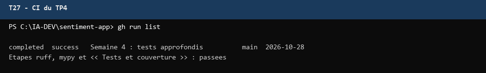

### T27a · Le modèle sert-il tous les avis de la même façon ? (étape F, complément)

```powershell
python C:\IA-DEV\complements-lot1\appliquer_complements.py C:\IA-DEV\sentiment-app --etape tp4
python src/biais.py
python -m pytest tests/test_biais.py -q
```

**Attendu** : avis avec retournement : 17 avis, exactitude 0.588, 7 erreurs, 15 vers un humain ; avis directs : 41 avis, 1.000. Avis longs : 0.741, mais les 10 avis longs sans retournement sont tous justes. Puis `8 passed`.

**Obtenu** :

```text
Avec retournement : 17 avis, exactitude 0.588, 7 erreurs, 15 vers humain, 2 restantes
Direct : 41 avis, exactitude 1.000 ; court : 31 avis, 1.000 ; long : 27 avis, 0.741
Long direct : 10 avis, 1.000 — long avec retournement : 17 avis, 0.588
python -m pytest tests/test_biais.py -q : 8 passed
```

- [x] Conforme

**Commentaire** (pourquoi la longueur n'est-elle pas la cause ?) :

> Le groupe mal servi est celui des avis à retournement, pas des avis longs : les 10 avis longs sans retournement sont tous justes. L'abstention déplace le problème plus qu'elle ne le règle : 15 des 17 avis difficiles partent vers un humain. Effectifs faibles (17 avis) : à confirmer sur un vrai jeu.

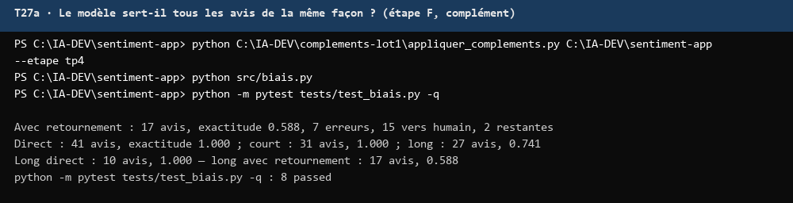

### Membre B, après le TP4

```powershell
git pull
pip install -r requirements-dev.txt
python src/train.py
pre-commit install
python -m pytest -q
```

**Attendu** : aucun `failed`.

**Obtenu** :

```text
À compléter
```

- [ ] Conforme


---

## TP5 : l'interface Streamlit

### T28 · Le kit installé (membre A)

```powershell
python C:\IA-DEV\tp5-interface\appliquer_tp5.py C:\IA-DEV\sentiment-app --simulation
python C:\IA-DEV\tp5-interface\appliquer_tp5.py C:\IA-DEV\sentiment-app
python src/train.py
python -m pytest -q
```

**Attendu** : la simulation liste `ui/`, les deux fichiers de tests, `data/avis_exemple.csv` et `docs/semaine5.md`, puis les compléments du `.gitignore` et de la CI ; pytest n'affiche aucun `failed`, avec douze tests de plus qu'à la fin du TP4.

**Obtenu** :

```text
python -m pytest -q : 94 passed, 3 xfailed (12 tests de plus qu'au TP4, aucun failed)
```

- [x] Conforme

**Commentaire** (que vérifient les tests du client, et ceux de la page ?) :

> Kit appliqué : ui/client.py (le seul à parler à l'API), ui/app.py (la page, qui ne décide rien), tests du client et de la page (AppTest), data/avis_exemple.csv.

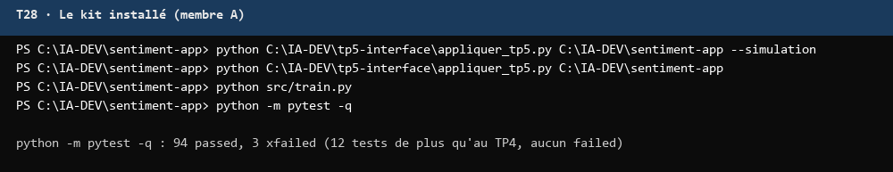

### T29 · La page ouverte, l'API prête

Deux terminaux, dans le dépôt :

```powershell
uvicorn api.main:app --reload
```

```powershell
streamlit run ui/app.py
```

**Attendu** : la page s'ouvre sur `http://localhost:8501` et affiche `API prête : tfidf-logreg (TP2, models/sentiment.joblib)`.

**Obtenu** :

```text
GET /health : {'status': 'OK', 'model': 'tfidf-logreg (TP2, models/sentiment.joblib)'}
→ en haut de la page : « API prête : tfidf-logreg (TP2, models/sentiment.joblib) »
```

- [x] Conforme

**Commentaire** :

> La santé de l'API est revérifiée à chaque réexécution du script Streamlit : l'arrêt de l'API se voit dès le rechargement de la page. Capture de la page à ajouter.

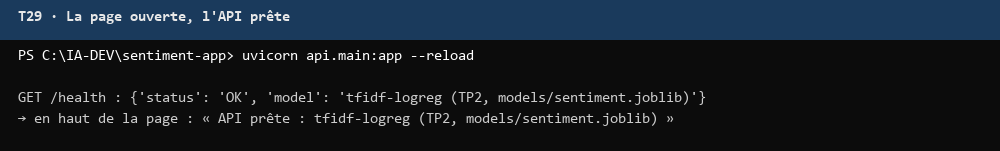

### T30 · Les verdicts

Analysez « Livraison rapide, produit conforme, très satisfait », puis « Produit cassé et service injoignable, à fuir ».

**Attendu** : Avis positif, 78 % ; puis Avis négatif, 75 %.

**Obtenu** :

```text
« Livraison rapide, produit conforme, très satisfait » → Avis positif, 78 % (0.777)
« Produit cassé et service injoignable, à fuir » → Avis négatif, 75 %
```

- [x] Conforme

**Commentaire** (d'où viennent ces pourcentages ?) :

> Mêmes scores que l'API appelée directement (T16, T17) : la page n'ajoute aucune logique, elle traduit.

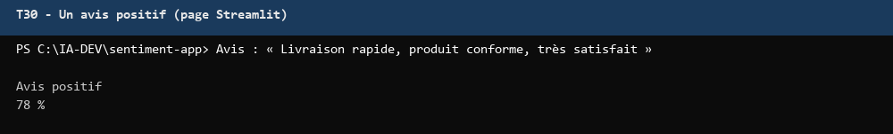

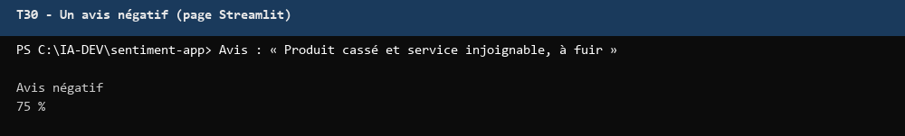

### T31 · L'abstention

Analysez « xqzvb wlkptr grombu ».

**Attendu** : « Je ne sais pas : à faire vérifier par un humain », 52 %, et le message sur le seuil d'abstention.

**Obtenu** :

```text
« xqzvb wlkptr grombu » → « Je ne sais pas : à faire vérifier par un humain », 52 % (0.5162)
+ encadré « La confiance est sous le seuil d'abstention : un humain doit trancher. »
```

- [x] Conforme

**Commentaire** (pourquoi cet affichage vaut-il mieux qu'un verdict forcé ?) :

> L'abstention du TP4 traverse toute la chaîne : modèle → API → client → page, avec un message en français au bout.

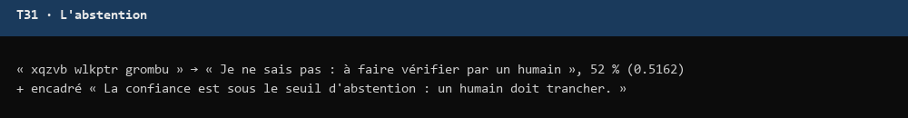

### T32 · Les erreurs

Analysez trois espaces. Arrêtez ensuite l'API (`Ctrl+C` dans son terminal), rechargez la page, puis relancez l'API.

**Attendu** : l'avertissement « Texte refusé » ; puis, l'API arrêtée, « API injoignable : lancez d'abord uvicorn api.main:app ».

**Obtenu** :

```text
Trois espaces → avertissement « Texte refusé : vide, fait d'espaces, ou de plus de 2000
caractères » (422). API arrêtée + rechargement → bandeau « API injoignable : lancez
d'abord uvicorn api.main:app ». Vérifié par tests/test_client.py et test_interface.py.
```

- [x] Conforme

**Commentaire** (quelle réponse de l'API se cache derrière chaque message ?) :

> Chaque code HTTP a son message : 422 → avertissement, 503 → « Modèle non chargé », connexion impossible → « API injoignable ». La page n'affiche jamais une trace technique.

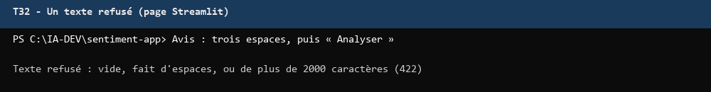

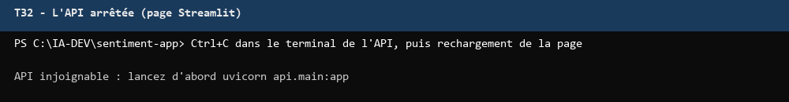

### T33 · Un fichier d'avis

Onglet « Un fichier d'avis », fichier `data/avis_exemple.csv`, puis « Télécharger les résultats ».

**Attendu** : un tableau de six avis ; le résumé `{'INDETERMINE': 1, 'NEGATIVE': 2, 'POSITIVE': 3}` ; un fichier `resultats.csv` téléchargé.

**Obtenu** :

```text
data/avis_exemple.csv : tableau de 6 avis avec verdict et confiance
Résumé : {'INDETERMINE': 1, 'NEGATIVE': 2, 'POSITIVE': 3}
Bouton « Télécharger les résultats » → resultats.csv
```

- [x] Conforme

**Commentaire** (combien d'avis partent vers un humain, et lesquels ?) :

> Un avis sur six part vers un humain (« xqzvb wlkptr grombu », 0,52). Le lot passe par la même fonction client que l'avis unique : mêmes verdicts, mêmes messages.

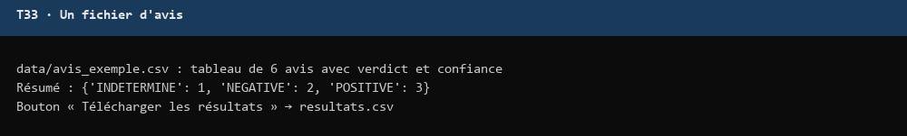

### T34 · Compte rendu, push, CI

```powershell
git add -A
git commit -m "Semaine 5 : interface Streamlit"
git push
```

**Attendu** : `docs/semaine5.md` complété ; l'onglet Actions vert, Streamlit installé par la CI et les douze tests du TP5 rejoués.

**Obtenu** :

```text
Commit « Semaine 5 : interface Streamlit » (5fa565b) poussé le 28/10.
CI du 28/10 : failure — pytest 9 en CI (monkeypatch ne restaure plus app.state).
Verte depuis le 04/11, après l'épinglage pytest==8.3.* du complément lot 1.
```

- [ ] Conforme

**Commentaire** :

> Rouge en CI, vert en local : la CI installait pytest sans épinglage et a reçu pytest 9, dont monkeypatch laisse l'API sans modèle pour le test suivant. Diagnostic confirmé par le LISEZ-MOI du lot 1, correction : « pytest==8.3.* » sur la ligne d'installation de ci.yml.

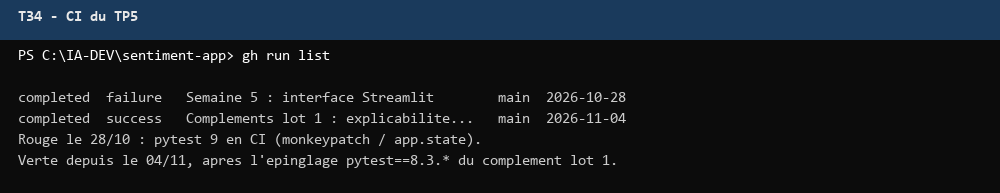

### T34a · Deux graphiques dans l'onglet fichier (étape G, complément)

```powershell
python C:\IA-DEV\complements-lot1\appliquer_complements.py C:\IA-DEV\sentiment-app --etape tp5
python -m pytest tests/test_graphiques.py tests/test_interface.py -q
streamlit run ui/app.py
```

**Attendu** : `9 passed` ; avec `data/avis_exemple.csv`, la répartition affiche positif 3, négatif 2, à vérifier 1, refus 0, et les confiances 1, 1, 3, 1, 0 avis de 50 à 100 %, par tranches de 10 points.

**Obtenu** :

```text
Répartition des verdicts : positif 3, négatif 2, à vérifier 1, refus ou erreur 0
Confiance par tranche : 50-60 % : 1 ; 60-70 % : 1 ; 70-80 % : 3 ; 80-90 % : 1 ; 90-100 % : 0
python -m pytest tests/test_graphiques.py tests/test_interface.py -q : 9 passed
```

- [x] Conforme

**Commentaire** (que montre le graphique des confiances que le tableau ne montre pas ?) :

> Les calculs vivent dans ui/graphiques.py, deux fonctions pures testées sans Streamlit ; la page ne fait qu'afficher. L'histogramme montre ce que le tableau cache : un avis tranché de justesse (50-60 %).

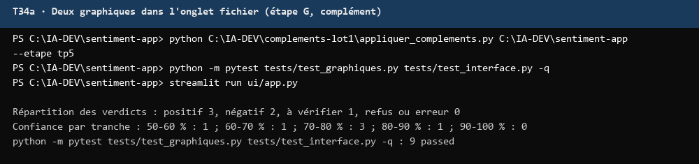

### Membre B, après le TP5

```powershell
git pull
python src/train.py
python -m pytest -q
streamlit run ui/app.py
```

**Attendu** : aucun `failed`, puis la page « API prête » une fois l'API lancée.

**Obtenu** :

```text
À compléter
```

- [ ] Conforme


---

## TP6 : packager l'application

### T35 · Le kit installé (membre A)

```powershell
python C:\IA-DEV\tp6-packaging\appliquer_tp6.py C:\IA-DEV\sentiment-app
pip install -r requirements-dev.txt
python -m pytest -q
```

**Attendu** : 2 failed, voulus : `test_le_modele_se_place_ou_l_on_veut` et `test_l_api_ne_bricole_plus_le_chemin_de_python`

**Obtenu** :

```text
python -m pytest -q : 2 failed, 98 passed, 3 xfailed
— test_le_modele_se_place_ou_l_on_veut (sentiment_app.predict n'existe pas encore)
— test_l_api_ne_bricole_plus_le_chemin_de_python (api/model.py modifie sys.path)
```

- [x] Conforme

**Commentaire** (que réclame chacun des deux échecs ?) :

> Deux échecs voulus : ils désignent exactement les étapes B et C du TP.

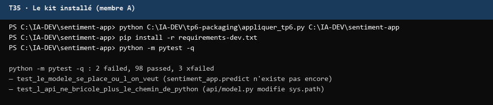

### T36 · predict.py dans le paquet

```powershell
git mv src/predict.py sentiment_app/predict.py
Copy-Item C:\IA-DEV\tp6-packaging\extraits\predict_compatibilite.py src\predict.py
python -m pytest -q
python src/predict.py "Livraison rapide, produit conforme, très satisfait"
```

**Attendu** : 1 failed ; `positive (confiance 78%)`

**Obtenu** :

```text
git mv src/predict.py sentiment_app/predict.py ; alias de compatibilité posé dans src/
chemin_modele() : SENTIMENT_MODELE, sinon models/sentiment.joblib sous la racine
python -m pytest -q : 1 failed (le test du sys.path, étape suivante)
python src/predict.py "Livraison rapide, …" : positive (confiance 78%)
```

- [x] Conforme

**Commentaire** (à quoi sert le fichier de compatibilité ?) :

> git mv garde l'historique du fichier. L'alias src/predict.py se remplace à l'import par le vrai module : les commandes et les tests du TP2 restent valides.

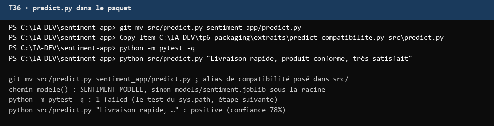

### T37 · L'API branchée sur le paquet

```powershell
python -m pytest -q
Select-String -Path api\*.py -Pattern "sys.path"
ruff check .
mypy api
```

**Attendu** : aucun failed ; `Select-String` ne trouve rien ; ruff et mypy muets

**Obtenu** :

```text
python -m pytest -q : 100 passed, 3 xfailed (aucun failed)
Select-String -Path api\*.py -Pattern "sys.path" : (rien)
ruff check . : All checks passed! ; mypy api : Success
```

- [x] Conforme

**Commentaire** (qu'est-ce qui a changé dans api/model.py ?) :

> api/model.py importe sentiment_app.predict comme n'importe quelle bibliothèque : plus de bricolage du chemin de Python à l'exécution.

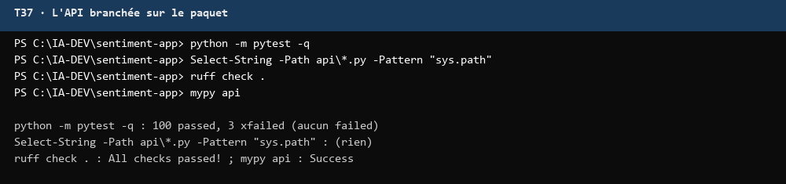

### T38 · La commande sentiment

```powershell
pip install -e .
sentiment --version
sentiment predict "Livraison rapide, produit conforme, très satisfait"
sentiment predict "xqzvb wlkptr grombu"
sentiment serve
```

**Attendu** : `sentiment-app 0.6.0` ; `POSITIVE` 0.777 ; `INDETERMINE` 0.5162 ; `/health` répond `OK`

**Obtenu** :

```text
sentiment --version : sentiment-app 0.6.0
sentiment predict "Livraison rapide, …" : {"label": "POSITIVE", "score": 0.777, …}
sentiment predict "xqzvb wlkptr grombu" : {"label": "INDETERMINE", "score": 0.5162, …}
sentiment serve : non rejoué (port 8000 occupé par l'API déjà lancée — même uvicorn api.main:app)
```

- [x] Conforme

**Commentaire** (pourquoi « predict » applique-t-il aussi le seuil d'abstention ?) :

> La commande passe par api/model.py, comme l'API : le seuil d'abstention s'applique aussi en ligne de commande. Install en mode développement : pip install -e . (fait avec --no-deps, voir Difficultés).

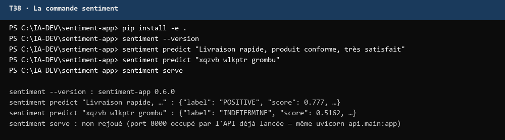

### T39 · La roue

```powershell
Remove-Item -Recurse -Force dist -ErrorAction SilentlyContinue
python -m build --wheel
```

**Attendu** : `sentiment_app-0.6.0-py3-none-any.whl`, avec `api`, `sentiment_app`, `ui` seulement

**Obtenu** :

```text
Successfully built sentiment_app-0.6.0-py3-none-any.whl
Contenu : ['api', 'sentiment_app', 'sentiment_app-0.6.0.dist-info', 'ui']
```

- [x] Conforme

**Commentaire** (pourquoi ni tests, ni données, ni modèle ?) :

> Ni tests, ni data, ni models, ni src dans la roue : on ne distribue que le code. Le modèle reste un artefact de déploiement.

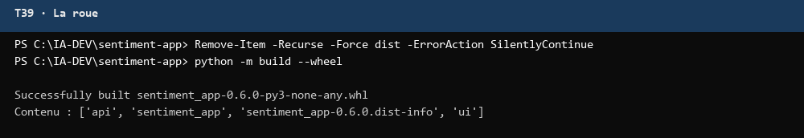

### T40 · La roue hors du dépôt

```powershell
cd $env:TEMP
py -3.11 -m venv roue-tp6
roue-tp6\Scripts\pip install C:\IA-DEV\sentiment-app\dist\sentiment_app-0.6.0-py3-none-any.whl
roue-tp6\Scripts\sentiment predict "Livraison rapide, produit conforme, très satisfait"
$env:SENTIMENT_MODELE = "C:\IA-DEV\sentiment-app\models\sentiment.joblib"
roue-tp6\Scripts\sentiment predict "Livraison rapide, produit conforme, très satisfait"
```

**Attendu** : sans la variable : « modèle introuvable », code 1 ; avec : `POSITIVE` 0.777

**Obtenu** :

```text
Environnement neuf (py -3.12, %TEMP%\roue-tp6) ; pip installe la roue et ses dépendances.
Sans SENTIMENT_MODELE : « modèle introuvable : …\roue-tp6\Lib\site-packages\models\
sentiment.joblib. Lancez python src/train.py, ou indiquez son chemin dans la variable
SENTIMENT_MODELE » — code de sortie 1.
Avec : {"label": "POSITIVE", "score": 0.777, …}
```

- [x] Conforme

**Commentaire** (qu'a-t-il fallu fournir à la roue, et qu'a-t-elle installé seule ?) :

> Le paquet fonctionne hors du dépôt avec deux seules choses : pip et le chemin d'un modèle. Le message d'erreur dit quoi faire, et le code de sortie 1 permet à un script de détecter l'échec.

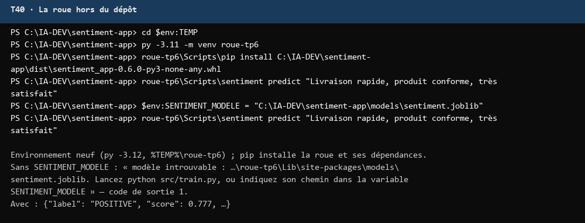

### T41 · Version, étiquette, push

```powershell
git add -A
git commit -m "Semaine 6 : paquet installable, version 0.6.0"
git tag -a v0.6.0 -m "TP6 : paquet installable"
git push
git push origin v0.6.0
```

**Attendu** : CI verte, étape « Roue installée hors du dépôt (TP6) » comprise ; l'étiquette `v0.6.0` visible sur GitHub

**Obtenu** :

```text
Commit « Semaine 6 : paquet installable, version 0.6.0 » (8523622), étiquette v0.6.0 poussée.
CI du 28/10 : failure (pytest 9, voir T34) → verte le 04/11 avec l'épinglage du lot 1,
y compris l'étape « roue installée hors du dépôt ».
```

- [x] Conforme

**Commentaire** :

> L'étiquette v0.6.0 est visible sur GitHub. La CI reconstruit la roue, l'installe dans un environnement neuf et vérifie une prédiction : le T40 est rejoué à chaque push.

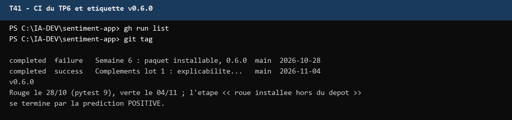

### T41a · La fiche modèle (étape G, complément)

```powershell
python C:\IA-DEV\complements-lot1\appliquer_complements.py C:\IA-DEV\sentiment-app --etape tp6
python -m pytest tests/test_fiche_modele.py -q
notepad docs\fiche-modele.md
python -m pytest tests/test_fiche_modele.py -q
```

**Attendu** : au départ `13 failed, 1 passed`, voulus ; une fois la fiche remplie, `14 passed` : version 0.6.0, F1 0.879 et rappel des négatifs 0.931 cités, un humain prévu dans les conditions d'usage.

**Obtenu** :

```text
Au départ : 13 failed, 1 passed (fiche vide) — voulu.
Fiche remplie avec les mesures du dépôt (F1 0.879, rappel négatifs 0.931, seuil 0.60,
jeu d'or 6/11/3, biais 0.588 contre 1.000, termes SHAP) : 14 passed.
```

- [x] Conforme

**Commentaire** (quelle rubrique a été la plus difficile à remplir, et pourquoi ?) :

> La fiche est testée comme les fiches de cadrage du TP1 : chiffres du dépôt exigés, version du paquet exacte, et un humain prévu dans les conditions d'usage. Réentraîner sans la mettre à jour fera échouer le test : c'est le but, la fiche suit le modèle.

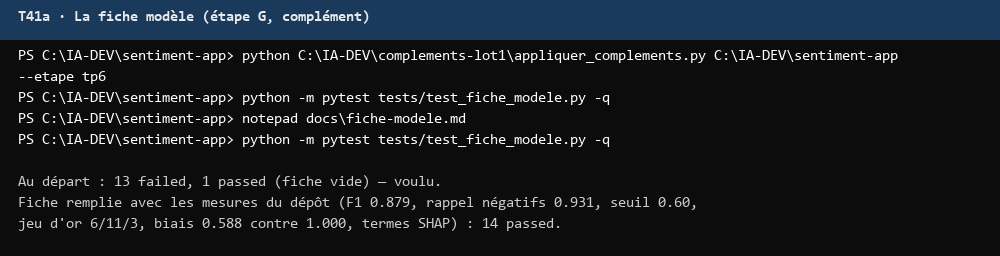

### Membre B, après le TP6

```powershell
git pull
pip install -e .
python -m pytest -q
sentiment --version
```

**Attendu** : aucun `failed`, puis `sentiment-app 0.6.0`.

**Obtenu** :

```text
À compléter
```

- [ ] Conforme


---

## Les difficultés rencontrées

Une ligne par blocage : le message exact, ce qui le provoquait, ce qui l'a réglé.

| TP | Commande | Message | Cause | Solution |
| --- | --- | --- | --- | --- |
| TP1 | `py -3.11 -m venv .venv` | `py -3.11` introuvable | Python 3.11 non installé | venv en 3.12.10, compatible avec les épinglages ; avertissement toléré |
| TP4 | `git commit` | `Executable mypy not found` (hook pre-commit) | venv non activé au moment du commit | activer `.venv` avant chaque commit |
| TP4 | `pytest tests/test_limites.py` | `detail` = `'texte vide'` (chaîne) | `ValueError` de `predict()` convertie en 422 avec son message | `field_validator` dans le schéma ; toute panne du modèle → 500 |
| TP6 | `pip install -e .` | `OSError [WinError 32] … uvicorn.exe` | API encore lancée (exe verrouillé) + conflit d'épinglage uvicorn (paquet <0.31, requirements 0.32) | requirements aligné sur `0.30.*` ; install `--no-deps` ; refaire `pip install -e .` une fois l'API fermée |
| TP5-TP6 | `git push` (CI) | 1 failed en CI, tout vert en local | CI sans épinglage : pytest 9, `monkeypatch` ne restaure plus `app.state` | `pytest==8.3.*` épinglé en CI (complément lot 1) |

## La répartition du travail

| TP | Ce qu'a fait le membre A | Ce qu'a fait le membre B |
| --- | --- | --- |
| TP1 | Kit, environnement, dépôt GitHub privé, premier push, fiches de cadrage | Invitation acceptée ; ligne du tableau du binôme *(à compléter)* |
| TP2 | Jeu de démonstration, entraînement, évaluation, metrics.json, push | Analyse des erreurs : docs/semaine2.md (commit 1c87374 du 14/10) |
| TP3 | Kit, API FastAPI, essais T15 à T20, docs/semaine3.md, push | *À compléter : réentraîner sur son poste, rejouer les essais* |
| TP4 | Point de départ mesuré, contrat d'entrée, abstention, jeu d'or, intégration, ruff/mypy/pre-commit, CI | *À compléter : ses 10 avis du jeu d'or, pre-commit install sur son clone* |
| TP5 | Kit, essais T29 à T33, docs/semaine5.md, push | *À compléter : T32 et T33 sur son poste* |
| TP6 | Paquet, roue, T35 à T41, étiquette v0.6.0, compléments du lot 1 | *À compléter : installer la roue sur son poste* |

## Le bilan

**TP1** :

> Un dépôt qui tient debout ailleurs que sur nos postes : structure, versions figées, .gitignore avant le premier commit. La leçon durable est l'arbre de choix — trois cas, trois approches différentes, et aucune n'était « un gros modèle ».

**TP2** :

> Un modèle simple et mesuré vaut mieux qu'un modèle impressionnant et invérifiable : F1 0,879, 7 erreurs toutes expliquées (le retournement des avis mitigés). Seule la mesure est versionnée, le modèle se reconstruit.

**TP3** :

> L'API ne fait que servir : elle appelle predict(), refuse de démarrer sans modèle, et répond 422 avant même que le modèle soit consulté. La page /docs a suffi pour tous les essais.

**TP4** :

> Le TP qui a le plus appris : les outils statiques n'avaient vu aucun des quatre défauts de comportement, et chaque défaut a été trouvé par un test qui exerce une frontière ou une panne. L'abstention (seuil 0,60) divise les erreurs par trois au prix de 28 % d'avis déroutés — et le biais mesuré montre qu'elle déplace le problème vers les avis à retournement.

**TP5** :

> Trois fichiers, trois rôles : la page affiche, le client traduit, l'API décide. Chaque panne a un message en français, et les douze tests passent sans lancer ni l'API ni la page.

**TP6** :

> Une roue de 0.6.0 qui s'installe hors du dépôt avec pip et une variable d'environnement : c'est la définition d'un livrable. La fiche modèle ferme la boucle : elle dit quand ne pas se servir du modèle, et ses chiffres sont testés contre le dépôt.

---

## Annexe A : comprendre tests/test_cadrage.py

Ce fichier contient les douze tests qui vérifient les trois fiches de cadrage du TP1 (contrôle T2). Pour l'afficher : `Get-Content tests\test_cadrage.py`. Il comprend deux constantes, deux fonctions outils, utilisées par les tests, et cinq tests, que pytest reconnaît parce que leur nom commence par `test_`.

### Les constantes

```python
REQUIRED_SECTIONS = [
    "Besoin en une phrase",
    "Utilisateur final",
    "Approche retenue",
    "Justification",
    "Données nécessaires",
    "Métrique de succès",
    "Conséquence d'une erreur",
    "Risques éthiques",
]
CRITERIA = ["(a)", "(b)", "(c)", "(d)"]
```

Les huit titres de rubrique attendus, et les quatre critères acceptés dans la justification : (a) données étiquetées, (b) vérifiabilité, (c) coût par requête, (d) conséquence d'une erreur. Elles sont en haut du fichier pour être lues sans chercher. Ne les modifiez pas pour faire passer un test : c'est précisément ce que la notation vérifie.

### Les deux fonctions outils

#### `fiches(cadrage_dir)`

```python
def fiches(cadrage_dir: Path):
    return sorted(cadrage_dir.glob("cas*.md"))
```

**Rôle :** donner la liste des fiches à contrôler.

- `cadrage_dir.glob("cas*.md")` cherche dans `docs/cadrage/` les fichiers dont le nom commence par `cas` et finit par `.md`.
- `sorted(...)` les range par ordre alphabétique : `cas1-pharmacie.md`, `cas2-reglement.md`, `cas3-avis-negatifs.md`.

**Conséquences :**

- `TEMPLATE.md`, `EXEMPLE-corrige.md` et `BANQUE-DE-CAS.md` ne commencent pas par `cas` : ils ne sont jamais contrôlés.
- Le tri explique pourquoi les erreurs apparaissent toujours d'abord sur `cas1`.

#### `section_body(text, title)`

```python
def section_body(text: str, title: str) -> str:
    pattern = re.compile(rf"^## {re.escape(title)}.*?$\n(.*?)(?=^## |\Z)", re.M | re.S)
    m = pattern.search(text)
    return m.group(1).strip() if m else ""
```

**Rôle :** extraire le texte d'une rubrique, c'est-à-dire tout ce qui se trouve entre son titre et le titre suivant.

L'expression régulière, morceau par morceau :

| Morceau | Ce qu'il reconnaît |
| --- | --- |
| `^## ` | Une ligne qui commence par `## ` (un titre de niveau 2) |
| `{re.escape(title)}` | Le titre exact. `re.escape` neutralise les caractères spéciaux, comme l'apostrophe de « Conséquence d'une erreur » |
| `.*?$` | La fin de la ligne de titre, quelle qu'elle soit : `## Justification (deux critères)` convient aussi |
| `\n` | Le saut de ligne qui termine le titre |
| `(.*?)` | **Ce qu'on capture** : le corps de la rubrique, le plus court possible |
| `(?=^## \|\Z)` | La limite : on s'arrête juste avant le prochain `## ` en début de ligne, ou à la fin du fichier (`\Z`), sans les inclure |

Les deux options :

- `re.M` fait agir `^` et `$` au début et à la fin de **chaque ligne**, et non du texte entier ;
- `re.S` permet au point de traverser les sauts de ligne, pour que le corps puisse tenir sur plusieurs lignes.

Ensuite, `m.group(1).strip()` renvoie le corps sans les espaces de début et de fin. Si le titre est absent, la fonction renvoie une chaîne vide.

**Un exemple.** Pour cette fiche :

```markdown
## Justification
> Citez au moins deux critères.
(a) Aucune donnée étiquetée n'existe. (d) Une erreur peut être grave.

## Données nécessaires
```

`section_body(texte, "Justification")` renvoie les deux lignes situées entre les deux titres : la consigne et la phrase rédigée.

### Les cinq tests

#### `test_three_fiches_exist`

```python
def test_three_fiches_exist(cadrage_dir: Path):
    assert len(fiches(cadrage_dir)) >= 3, "trois fiches cas*.md attendues dans docs/cadrage/"
```

**Vérifie** qu'il y a au moins trois fiches. Le paramètre `cadrage_dir` est une **fixture** : pytest le fournit automatiquement à partir de `tests/conftest.py`, qui le fait pointer vers `docs/cadrage/`. Le texte après la virgule de l'`assert` est le message affiché en cas d'échec.

**Échoue si** une fiche a été supprimée ou renommée, par exemple `Cas1.md` avec une majuscule.

#### `test_sections_present_in_every_fiche` (8 tests)

```python
@pytest.mark.parametrize("title", REQUIRED_SECTIONS)
def test_sections_present_in_every_fiche(cadrage_dir: Path, title):
    for fiche in fiches(cadrage_dir):
        assert f"## {title}" in fiche.read_text(encoding="utf-8"), f"{fiche.name} : rubrique '{title}' absente"
```

**Vérifie** que chaque titre de rubrique figure dans chaque fiche.

- Le décorateur `@pytest.mark.parametrize` exécute la fonction **une fois par rubrique**, avec `title` qui prend tour à tour les huit valeurs de `REQUIRED_SECTIONS`. Une seule fonction donne donc huit tests, affichés par exemple `test_sections_present_in_every_fiche[Justification]`.
- Pour chaque rubrique, la boucle parcourt les trois fiches et cherche le texte exact `## <titre>`.

**Échoue si** un titre a été modifié ou supprimé : `## justification` sans majuscule, ou `### Justification` avec trois dièses au lieu de deux, ne correspondent pas. Ces huit tests passent dès le départ, puisque les fiches du kit contiennent déjà les titres. Ils protègent la structure.

#### `test_sections_are_filled`

```python
def test_sections_are_filled(cadrage_dir: Path):
    empty = []
    for fiche in fiches(cadrage_dir):
        text = fiche.read_text(encoding="utf-8")
        for title in REQUIRED_SECTIONS:
            if title == "Approche retenue":
                continue
            body = section_body(text, title)
            body = "\n".join(
                l for l in body.splitlines() if l.strip() and not l.startswith(">") and not l.startswith("- [")
            )
            if len(body) < 20:
                empty.append(f"{fiche.name} / {title}")
    assert not empty, "rubriques vides ou trop courtes : " + ", ".join(empty)
```

**Vérifie** que chaque rubrique contient au moins 20 caractères **rédigés par le binôme**.

1. Pour chaque fiche et chaque rubrique, sauf « Approche retenue » qui ne contient que des cases à cocher, la fonction extrait le corps avec `section_body`.
2. Elle retire trois sortes de lignes :
   - les lignes vides (`l.strip()` est faux) ;
   - les consignes du modèle, qui commencent par `>` ;
   - les cases à cocher, qui commencent par `- [`.
3. Elle mesure ce qui reste. Sous 20 caractères, la rubrique est notée dans la liste `empty`.
4. L'`assert` final échoue si la liste n'est pas vide.

Contrairement aux autres tests, celui-ci **rassemble toutes les rubriques trop courtes** avant d'échouer : son message les liste toutes, sous la forme `cas1-pharmacie.md / Besoin en une phrase, cas1-pharmacie.md / Justification, ...`.

**Une subtilité :** `startswith(">")` teste le début exact de la ligne. Une consigne précédée d'espaces, comme `  > texte`, n'est donc pas retirée.

#### `test_exactly_one_approach_checked`

```python
def test_exactly_one_approach_checked(cadrage_dir: Path):
    for fiche in fiches(cadrage_dir):
        text = fiche.read_text(encoding="utf-8")
        assert text.count("- [x]") == 1, f"{fiche.name} : cocher exactement une approche"
```

**Vérifie** qu'une seule approche est cochée par fiche. `text.count("- [x]")` compte les occurrences exactes de `- [x]` **dans tout le fichier**, et le test exige exactement 1.

**Échoue si :**

- aucune case n'est cochée, comme dans les fiches du kit : le compte vaut 0 ;
- deux cases sont cochées : le compte vaut 2 ;
- la case est écrite autrement : `- [X]` avec un X majuscule, `-[x]` sans espace, ou `[x]` sans tiret ne comptent pas.

La boucle s'arrête à la **première fiche fautive**, dès qu'un `assert` échoue.

#### `test_justification_cites_two_criteria`

```python
def test_justification_cites_two_criteria(cadrage_dir: Path):
    for fiche in fiches(cadrage_dir):
        body = section_body(fiche.read_text(encoding="utf-8"), "Justification")
        cited = [c for c in CRITERIA if c in body]
        assert len(cited) >= 2, f"{fiche.name} : la justification doit citer au moins deux critères (a), (b), (c), (d)"
```

**Vérifie** que la justification s'appuie sur au moins deux critères.

1. La fonction extrait le corps de la rubrique « Justification ».
2. La liste `cited` garde, parmi `(a)`, `(b)`, `(c)` et `(d)`, ceux qui apparaissent dans ce corps.
3. Il en faut au moins deux.

**Échoue si :**

- les critères sont cités ailleurs que sous « Justification » ;
- ils sont écrits autrement : `a)` sans parenthèse ouvrante, ou `(A)` en majuscule, ne comptent pas.

Ici, les consignes ne sont **pas retirées** du corps : une consigne qui contiendrait « (a) » compterait. C'est aussi un test qui s'arrête à la première fiche fautive.

Le test ne vérifie que la **présence** des lettres. Que les critères cités s'appliquent vraiment au cas, c'est l'enseignant qui le juge à la lecture : la grille du TP1 y consacre 4 points sur 10.

### Lancer ces tests seuls

```powershell
python -m pytest tests/test_cadrage.py -q
python -m pytest tests/test_cadrage.py -v
```

La première commande affiche un caractère par test (`.` réussi, `F` échoué, `s` ignoré), puis une ligne de bilan : `12 passed` quand les trois fiches sont complètes. La seconde affiche le nom de chaque test et son résultat.


---

## Annexe B : le TP2 en détail

Les valeurs ci-dessous ont été mesurées sur le jeu de démonstration, avec la graine fixée du kit : vous devez obtenir exactement les mêmes.

### Les résultats attendus, contrôle par contrôle

| Contrôle | Commande | Résultat attendu |
| --- | --- | --- |
| C1 | `python -m pytest -q`, juste après `appliquer_tp2.py` | 2 failed, 38 passed, 2 skipped : les deux échecs réclament `models/metrics.json`, les deux tests ignorés attendent le modèle |
| C2 | `python src/make_demo.py` | `290 avis écrits`, 145 positifs et 145 négatifs, dont 100 mitigés et 30 neutres |
| C3 | `python src/train.py`, puis `git status --short` | `Vocabulaire : 316 termes`, `F1 macro sur le jeu de test : 0.879 (seuil 0.85)` ; `models/metrics.json` apparaît, ni `models/sentiment.joblib` ni `data/demo_reviews.csv` |
| C4 | `python src/evaluate.py` | La matrice `27 2` sur la ligne `negative`, `5 24` sur la ligne `positive` : 7 erreurs sur 58 |
| C5 | `python src/train.py --allocine`, puis `python -m pytest -q` | `Source : allocine, 20000 avis`, F1 macro 0,920 sur 4 000 avis de test, puis 42 passed |

### Les sept erreurs du jeu de démonstration

`python src/evaluate.py` n'en affiche que trois. Voici les sept :

| Vérité | Prédit | Avis | Retournement |
| --- | --- | --- | --- |
| positive | negative | Taille trop petite et retour payant au déballage, sauf que ensuite produit conforme à la description, très satisfait. | sauf que ensuite |
| positive | negative | Commande jamais reçue et remboursement en attente au début, sauf que ensuite je recommande sans hésiter. | sauf que ensuite |
| negative | positive | Service impeccable et livraison en avance sur le papier, sauf que ensuite produit cassé à l'arrivée. | sauf que ensuite |
| positive | negative | Facture erronée, aucun geste commercial sur le papier, puis rapidement service impeccable et livraison en avance. | puis rapidement |
| positive | negative | Commande jamais reçue et remboursement en attente au début, avant que emballage soigné et finitions propres. | avant que |
| negative | positive | Service impeccable et livraison en avance les premiers jours, avant que notice incompréhensible et pièces manquantes. | avant que |
| positive | negative | Se casse au bout de deux utilisations à la livraison, mais finalement excellent rapport qualité prix. | mais finalement |

Ce sont tous des avis mitigés : ils commencent dans un sens, puis se retournent. Dans les sept cas, la prédiction suit la première partie de l'avis, alors que le verdict est donné par la fin.

### Un exemple de docs/semaine2.md

L'énoncé demande trois phrases : quelles erreurs, pourquoi, et ce qu'il faudrait pour les corriger. C'est la partie « Analyse des erreurs » ci-dessous ; la partie « Mesures » donne le contexte. **C'est un exemple : écrivez votre compte rendu avec vos propres mots.** Des comptes rendus identiques d'un binôme à l'autre font partie des signaux d'alerte de la grille.

```markdown
# Semaine 2 : le modèle de sentiment

## Mesures

| Jeu de données | Avis de test | F1 macro |
| --- | --- | --- |
| Démonstration (290 avis) | 58 | 0,879 |
| Allociné (20 000 avis) | 4 000 | 0,920 |

Sur le jeu de démonstration, la matrice de confusion compte 27 négatifs et 24 positifs bien classés,
2 négatifs classés positifs et 5 positifs classés négatifs : 7 erreurs sur 58.

## Analyse des erreurs

Les 7 erreurs portent toutes sur des avis mitigés, qui commencent dans un sens et se retournent
ensuite (« sauf que ensuite », « mais finalement », « avant que », « puis rapidement ») : par
exemple, « Taille trop petite et retour payant au déballage, sauf que ensuite produit conforme à la
description, très satisfait » est classé négatif alors qu'il est positif. Dans chacune de ces 7
erreurs, la prédiction suit la première partie de l'avis, alors que le verdict est donné par la fin :
le modèle additionne les poids des mots sans tenir compte de leur ordre, et un sac de mots ne voit
pas qu'un connecteur comme « sauf que » renverse le sens de ce qui précède. Pour corriger ces
erreurs, il faudrait une représentation qui tient compte de l'ordre et du contexte des mots, comme
les embeddings de phrase vus en semaine 9.
```

Trois remarques :

- **Vérifiez vos chiffres.** Si `python src/evaluate.py` ne donne pas la matrice `27 2` / `5 24`, le modèle n'est pas celui du jeu de démonstration : relancez `python src/train.py`, sans `--allocine`.
- **N'évoquez pas les bigrammes comme remède.** Le vectoriseur en utilise déjà : son vocabulaire contient par exemple « service client ». Ils ne suffisent pas, car le retournement porte sur toute la phrase.
- **Si le téléchargement d'Allociné a échoué**, remplacez la deuxième ligne du tableau par une phrase qui le signale.

Ce critère vaut 2 points sur 10 au TP2 : la lecture vérifie surtout que les avis mitigés sont identifiés et que la limite du sac de mots est expliquée.

### Finir le TP2

**1. Vérifier ce qui part dans Git, puis pousser.**

```powershell
git status --short
git add -A
git commit -m "Semaine 2 : modele de sentiment, metriques et tests"
git push
```

`git status` doit montrer `src/`, `tests/test_model.py`, `notebooks/`, `docs/semaine2.md`, `models/metrics.json` et les deux documents du TP ; jamais `models/sentiment.joblib` ni `data/demo_reviews.csv`, qui sont ignorés.

**2. La CI.** Dans l'onglet Actions, la nouvelle exécution doit être verte, avec 42 passed dans l'étape des tests. Sur GitHub, la CI n'a pas le modèle : les deux tests de prédiction y sont ignorés, et les deux tests de métriques lisent `metrics.json`.

**3. La part du membre B.** Chaque membre doit commiter dans chaque TP. Sur son poste, le membre B fait `git pull`, `python src/make_demo.py`, `python src/train.py`, puis `python -m pytest -q` (42 passed), et rédige une partie de `docs/semaine2.md`. Si une seule personne joue les deux rôles, elle commite cette partie sous l'identité du membre B, la même qu'au TP1 :

```powershell
git add docs/semaine2.md
git -c user.name="Nom du membre B" -c user.email="adresse-du-membre-B" commit -m "Semaine 2 : analyse des erreurs"
git push
```

**4. Avant le TP3.** Le TP2 se termine sur le modèle Allociné, alors que les tests de l'API attendent le modèle de démonstration, celui que la CI entraîne. Après avoir installé le kit du TP3, lancez donc `python src/train.py`, sans `--allocine`, avant `python -m pytest -q` (contrôle T14 : 48 passed). Si votre chemin de travail contient des espaces, mettez les chemins des commandes entre guillemets.


---

## Annexe C : comprendre src/train.py

`src/train.py` entraîne le modèle de sentiment et le sauvegarde. Il produit deux fichiers : `models/sentiment.joblib`, le modèle, qui reste hors de Git ; et `models/metrics.json`, sa mesure, qui est versionnée. Il s'utilise de deux façons :

```powershell
python src/train.py              # jeu de démonstration (data/demo_reviews.csv)
python src/train.py --allocine   # vrai jeu public : 20 000 avis Allociné
```

### Les constantes, en tête du fichier

```python
RACINE = Path(__file__).resolve().parents[1]
DEMO = RACINE / "data" / "demo_reviews.csv"
URL_ALLOCINE = "https://huggingface.co/datasets/tblard/allocine/resolve/main/allocine/validation-00000-of-00001.parquet"
MODELE = RACINE / "models" / "sentiment.joblib"
METRIQUES = RACINE / "models" / "metrics.json"
SEUIL_F1 = 0.85
GRAINE = 42
```

| Constante | Rôle |
| --- | --- |
| `RACINE` | La racine du dépôt, calculée à partir de l'emplacement du script : celui-ci fonctionne quel que soit le dossier courant |
| `DEMO` | Le jeu de démonstration, écrit par `make_demo.py` |
| `URL_ALLOCINE` | Le jeu public Allociné, hébergé sur Hugging Face au format Parquet : 20 000 critiques de films |
| `MODELE`, `METRIQUES` | Les deux fichiers produits |
| `SEUIL_F1` | Le F1 minimal attendu, 0,85. Le script se contente de l'afficher : c'est `test_model.py` qui le fait respecter |
| `GRAINE` | La graine du hasard, 42 : deux exécutions donnent exactement le même découpage et le même modèle |

`evaluate.py` et `courbe_seuil.py` importent `GRAINE`, `MODELE` et `charger` depuis ce fichier. Ils retrouvent ainsi exactement le même jeu de test.

### `charger(allocine)` : lire les données

```python
def charger(allocine: bool) -> tuple[pd.DataFrame, str]:
    if allocine:
        df = pd.read_parquet(URL_ALLOCINE)
        df["label"] = df["label"].map({0: "negative", 1: "positive"})
        return df[["review", "label"]].dropna(), "allocine"
    if not DEMO.exists():
        raise SystemExit("data/demo_reviews.csv absent : lancez d'abord python src/make_demo.py")
    return pd.read_csv(DEMO), "demo"
```

La fonction renvoie un tableau à deux colonnes, `review` (le texte) et `label` (`positive` ou `negative`), ainsi que le nom de la source.

- **Allociné** : elle télécharge le fichier, ce qui demande une connexion et pyarrow. Les étiquettes 0 et 1 deviennent `negative` et `positive`, comme dans le jeu de démonstration, et les lignes incomplètes sont retirées.
- **Démonstration** : elle lit le CSV. S'il manque, elle s'arrête avec un message qui dit quoi faire.

### `construire_pipeline()` : le modèle

```python
return Pipeline([
    ("tfidf", TfidfVectorizer(ngram_range=(1, 2), min_df=2, sublinear_tf=True)),
    ("clf", LogisticRegression(max_iter=1000, class_weight="balanced", random_state=GRAINE)),
])
```

Le modèle a **deux étages**. Le vectoriseur TF-IDF transforme chaque texte en vecteur de nombres, puis la régression logistique classe ce vecteur.

| Réglage | Effet |
| --- | --- |
| `ngram_range=(1, 2)` | Le vocabulaire contient les mots seuls et les **paires de mots consécutifs** (bigrammes), comme « service client » |
| `min_df=2` | Un terme présent dans moins de deux avis d'entraînement est ignoré : moins de bruit. Le jeu de démonstration donne 316 termes |
| `sublinear_tf=True` | Un mot répété compte de moins en moins : son poids croît comme 1 + log(fréquence), et non proportionnellement |
| `max_iter=1000` | Laisse à l'optimisation le temps de converger |
| `class_weight="balanced"` | Compense un éventuel déséquilibre entre avis positifs et négatifs |
| `random_state=GRAINE` | Résultat reproductible |

**Pourquoi un `Pipeline` ?** Le vectoriseur et le classifieur forment un seul objet, sauvegardé d'un bloc. En production, `predict()` applique donc forcément la même transformation qu'à l'entraînement. Sauvegarder le classifieur seul est un piège classique : sans son vocabulaire, il est inutilisable.

### `main()` : les étapes, dans l'ordre

**a. Lire les options et les données**, puis afficher la source : `Source : demo, 290 avis (145 négatifs)`.

**b. Découper avant toute transformation.**

```python
X_train, X_test, y_train, y_test = train_test_split(
    df["review"], df["label"], test_size=0.2, random_state=GRAINE, stratify=df["label"]
)
```

- 20 % des avis sont mis de côté pour le test : 232 pour l'entraînement et 58 pour le test sur le jeu de démonstration, 16 000 et 4 000 sur Allociné.
- `stratify` garde la même proportion de positifs et de négatifs dans les deux parties.
- **Le découpage précède la vectorisation**, et c'est le point essentiel du script. Si le vectoriseur apprenait son vocabulaire sur toutes les données, le jeu de test « fuirait » dans l'entraînement, et le score serait artificiellement bon.

**c. Entraîner.** `pipeline.fit(X_train, y_train)` apprend le vocabulaire et les poids **uniquement sur les avis d'entraînement**. Le script affiche ensuite `Vocabulaire : 316 termes`.

**d. Mesurer sur le jeu de test.** `classification_report` compare les prédictions aux vraies étiquettes des 58 avis jamais vus. Le script en retient le **F1 macro**, la moyenne des F1 des deux classes, chacune comptant autant, et l'affiche : `F1 macro sur le jeu de test : 0.879 (seuil 0.85)`.

**e. Sauvegarder.**

- `joblib.dump(pipeline, MODELE)` écrit le modèle, un fichier binaire, ignoré par Git.
- `metrics.json` reçoit la source, la date, les tailles d'entraînement et de test, le F1 macro, l'exactitude, le rappel de la classe négative et le seuil. Ce petit fichier texte est versionné : il garde la trace de chaque mesure, et la CI le lit sans avoir le modèle.

Sur le jeu de démonstration, la sortie complète est :

```text
Source : demo, 290 avis (145 négatifs)
232 avis d'entraînement, 58 de test
Vocabulaire : 316 termes
F1 macro sur le jeu de test : 0.879 (seuil 0.85)
Modèle : models/sentiment.joblib
Métriques : models/metrics.json (versionné dans Git, contrairement au modèle)
```

### Ce qu'il faut savoir en pratique

- **`--allocine` écrase le modèle de démonstration.** Les tests de l'API (TP3 et suivants) attendent le modèle de démonstration, celui que la CI entraîne : relancez `python src/train.py`, sans option, avant `pytest`.
- **`metrics.json` change à chaque entraînement**, même si le F1 est identique, parce qu'il contient la date du jour. C'est pourquoi `git status` le montre modifié.
- **Le modèle dépend de la version de scikit-learn** qui l'a produit. Un modèle entraîné avec une version et relu par une autre peut échouer ; c'est l'objet du TP6.
- **Un avertissement `OptimizeWarning: Unknown solver options: iprint`** peut apparaître avec une version récente de SciPy : il est sans conséquence.


---

## Annexe D : les contrôles T15 à T20 expliqués

Les réponses citées ont été mesurées sur l'API du TP3, avec le modèle de démonstration : vous devez obtenir exactement les mêmes.

### Ce qui se passe au lancement de l'API

```powershell
uvicorn api.main:app --reload
```

`uvicorn` est le serveur web : il lance l'application `app` du fichier `api/main.py`, sur le port 8000. `--reload` la relance à chaque modification du code. Au démarrage, la fonction `lifespan` de `main.py` charge le modèle **une seule fois**, avant la première requête, et le range dans `app.state.classifier`. Le terminal l'annonce :

```text
INFO     Démarrage de l'API...
INFO     Modèle chargé avec succès : tfidf-logreg (TP2, models/sentiment.joblib)
INFO:    Application startup complete.
```

Ensuite, chaque requête suit le même chemin :

1. FastAPI choisit la fonction de la route : `health_check` pour `GET /health`, `predict` pour `POST /predict`.
2. Pour `/predict`, **Pydantic vérifie le corps de la requête** avec le contrat `PredictRequest` de `api/schemas.py` : un champ `text`, une chaîne de 1 à 2000 caractères. Si le corps ne respecte pas ce contrat, FastAPI répond 422 **sans même exécuter la fonction**.
3. `_classifier()` récupère le modèle chargé au démarrage, ou répond 503 s'il manque.
4. `api/model.py` appelle `predict()` du TP2, puis met l'étiquette en majuscules.
5. La réponse est vérifiée par le contrat `PredictResponse`, puis renvoyée en JSON.

**La page `/docs`.** FastAPI génère à partir du code une page de test, `http://localhost:8000/docs`. Pour chaque route : la déplier, cliquer sur « Try it out », saisir le corps de la requête, puis « Execute ». La réponse s'affiche sous « Code » (le code HTTP) et « Response body » (le JSON), et une ligne s'ajoute dans le terminal de l'API.

### T15 : GET /health, l'API est-elle prête ?

**Ce qu'on fait :** `GET /health`, sans corps.

**Ce qui se passe :** `health_check` appelle `_classifier()`. Si le modèle est chargé, elle renvoie son nom ; sinon, `_classifier()` lève une erreur 503, « Modèle non chargé ».

**Attendu :** `200`, et

```json
{"status": "OK", "model": "tfidf-logreg (TP2, models/sentiment.joblib)"}
```

**Pourquoi c'est utile :** les outils de déploiement et de surveillance interrogent `/health` en boucle pour savoir si le service est prêt à recevoir des requêtes. La page Streamlit du TP5 s'en sert aussi, pour afficher « API prête ».

### T16 et T17 : POST /predict, deux avis évidents

**Ce qu'on fait :** `POST /predict` avec `{"text": "Livraison rapide, produit conforme, très satisfait"}`, puis avec `{"text": "Produit cassé et service injoignable, à fuir"}`.

**Attendu :**

```json
{"label": "POSITIVE", "score": 0.777, "text": "Livraison rapide, produit conforme, très satisfait"}
{"label": "NEGATIVE", "score": 0.7465, "text": "Produit cassé et service injoignable, à fuir"}
```

| Champ | Ce qu'il contient |
| --- | --- |
| `label` | L'étiquette du modèle (`positive` ou `negative`), mise en majuscules par `api/model.py` |
| `score` | La confiance du modèle dans la classe prédite : la plus grande des deux probabilités, entre 0,5 et 1 |
| `text` | Les 100 premiers caractères de l'avis, pour vérifier ce qui a été analysé |

Le terminal de l'API ajoute une ligne par requête, par exemple `predict: 'Livraison rapide, produit conforme, très sati' -> POSITIVE (0.78)`. Les scores sont exactement 0,777 et 0,7465 parce que le modèle de démonstration est entraîné avec une graine fixée. Si vous obtenez d'autres valeurs, le modèle chargé est celui d'Allociné : `python src/train.py`, sans option, puis relancez l'API.

### T18 : trois requêtes invalides, trois refus 422

**Ce qu'on fait :** `POST /predict` avec `{"text": ""}`, puis `{}`, puis `{"text": 42}`.

**Ce qui se passe :** Pydantic refuse les trois corps avant que la fonction `predict` ne s'exécute. FastAPI répond 422 (« Unprocessable Entity », requête mal formée) avec un `detail` qui est une **liste** d'erreurs. Dans chacune, `loc` désigne le champ fautif, `msg` explique le refus et `type` le classe :

| Corps envoyé | `type` | `loc` | `msg` |
| --- | --- | --- | --- |
| `{"text": ""}` | `string_too_short` | `["body", "text"]` | String should have at least 1 character |
| `{}` | `missing` | `["body", "text"]` | Field required |
| `{"text": 42}` | `string_type` | `["body", "text"]` | Input should be a valid string |

**Pourquoi 422 et pas 500 :** l'erreur vient du client, qui a envoyé une requête invalide ; le serveur, lui, fonctionne. Un 500 signalerait une panne du serveur.

**À observer, sans le corriger :** envoyez aussi `{"text": "   "}`, trois espaces. La requête passe le contrat (elle a bien un caractère au moins), puis `predict()` du TP2 la refuse. `main.py` transforme ce refus en 422, mais avec un `detail` qui est une simple chaîne : `{"detail": "texte vide"}`. Deux formes pour le même refus : c'est le premier défaut que le TP4 fera trouver et corriger.

### T19 : la CI entraîne le modèle, puis teste l'API

**Ce qu'on fait :** `git add -A`, `git commit`, `git push`, puis l'onglet Actions sur GitHub.

**Ce qui se passe :** le kit du TP3 a modifié la CI. Elle installe désormais FastAPI, httpx et uvicorn, et une nouvelle étape, « Modèle de démonstration, pour les tests de l'API (TP3) », lance `make_demo.py` puis `train.py` **avant** les tests. Le modèle n'est jamais dans Git : sans cette étape, les six tests de l'API seraient ignorés sur GitHub, faute de modèle à charger. Le kit a aussi ajouté `pythonpath = .` à `pytest.ini`, pour que les tests trouvent le paquet `api`.

**Attendu :** les étapes sont toutes vertes, et l'étape « Tests » affiche `48 passed`.

### T20 : sans modèle, l'API refuse de démarrer

**Ce qu'on fait :**

```powershell
Rename-Item models/sentiment.joblib sentiment.bak
uvicorn api.main:app
Rename-Item models/sentiment.bak sentiment.joblib
```

**Ce qui se passe :** au démarrage, `lifespan` appelle `load_model()`, qui appelle `charger_modele()` du TP2. Le fichier manque : `charger_modele()` lève une `FileNotFoundError`, le démarrage échoue, et uvicorn s'arrête.

**Attendu :**

```text
INFO     Démarrage de l'API...
ERROR:    Traceback (most recent call last):
FileNotFoundError: models/sentiment.joblib absent : lancez python src/train.py
ERROR:    Application startup failed. Exiting.
```

Lancez la troisième commande seulement après cet échec : elle remet le modèle en place.

**Pourquoi refuser de démarrer plutôt que répondre 503 :** une API sans modèle ne pourra jamais répondre correctement. En refusant de démarrer, elle rend la panne visible tout de suite, au moment du déploiement, au lieu de paraître en marche et de répondre 503 à chaque client. Le code 503 sert aux indisponibilités passagères, quand le modèle a été retiré en cours de route.

### Les mêmes essais en ligne de commande

L'API lancée dans un autre terminal, `httpx`, installé avec `requirements.txt`, permet les mêmes essais :

```powershell
python -c "import httpx; print(httpx.get('http://127.0.0.1:8000/health').json())"
python -c "import httpx; r = httpx.post('http://127.0.0.1:8000/predict', json={'text': 'Livraison rapide, produit conforme, très satisfait'}); print(r.status_code, r.json())"
python -c "import httpx; print([httpx.post('http://127.0.0.1:8000/predict', json=c).status_code for c in ({'text': ''}, {}, {'text': 42})])"
```

Attendu : le JSON de T15, puis `200` et le JSON de T16, puis `[422, 422, 422]`.

### Le lien avec docs/semaine3.md

Les deux questions du compte rendu s'appuient sur ces contrôles :

- **Pourquoi l'API refuse-t-elle de démarrer sans modèle, plutôt que de répondre 503 ?** Ce que vous avez vu en T20.
- **Un texte vide est refusé deux fois, par Pydantic puis par `predict()` : est-ce redondant ?** Ce que vous avez vu en T18, avec `""` puis avec `"   "`.


---

## Annexe E : l'interface de l'API, la page /docs

FastAPI génère automatiquement une interface web pour essayer l'API : `http://localhost:8000/docs`, qui s'ouvre une fois l'API lancée par `uvicorn api.main:app --reload`. Rien n'y est écrit à la main : la page est construite à partir du code, c'est-à-dire des décorateurs de routes de `api/main.py`, de leurs `summary` et docstrings, et des contrats Pydantic de `api/schemas.py`. Modifier le code modifie la page.

### La structure de la page, de haut en bas

**1. L'en-tête.**

- Le titre, « Sentiment Analysis API », et la description, « Classifie le sentiment d'un avis en français (modèle du TP2) » : ce sont les paramètres `title` et `description` de `FastAPI(...)` dans `main.py`.
- Deux étiquettes : `1.0.0`, la version de l'API (paramètre `version`), et `OAS 3.1`, la norme OpenAPI 3.1 dans laquelle la description de l'API est écrite.
- Un lien, `/openapi.json` : la même description, en JSON, lisible par des programmes.

**2. Les routes**, regroupées sous « default ». Chacune est une barre de couleur, avec sa méthode, son chemin et son résumé :

| Barre | Route | Résumé | Fonction dans `main.py` |
| --- | --- | --- | --- |
| GET, en bleu | `/` | Accueil | `root` |
| GET, en bleu | `/health` | Santé de l'API | `health_check` |
| POST, en vert | `/predict` | Classifier un texte | `predict` |

**3. Une route, une fois dépliée.** Pour `POST /predict` :

- **La description** : la docstring de la fonction, qui annonce les codes 422, 503 et 500.
- **Parameters** : aucun, car tout passe par le corps de la requête.
- **Request body**, obligatoire, au format `application/json`. L'onglet « Example Value » montre `{"text": "Livraison rapide, produit conforme, très satisfait"}`, l'exemple déclaré dans `schemas.py`. L'onglet « Schema » montre le contrat : un champ `text`, une chaîne de 1 à 2000 caractères.
- **Responses** : les codes documentés, `200` (« Successful Response », avec un exemple de `PredictResponse`) et `422` (« Validation Error »). Les codes 503 et 500 existent dans le code, mais ne sont pas déclarés : la page ne les montre pas. C'est une limite de la documentation automatique.
- **Deux boutons.** « Try it out » rend le corps modifiable ; « Execute » envoie la requête. Apparaissent alors :
  - **Curl** : la commande équivalente en ligne de commande ;
  - **Request URL** : l'adresse appelée ;
  - **Server response** : le code (`Code`), le JSON reçu (`Response body`) et les en-têtes.

**4. En bas, « Schemas ».** Les contrats de données :

- `PredictRequest`, `PredictResponse` et `HealthResponse`, définis dans `schemas.py` ;
- `HTTPValidationError` et `ValidationError`, ajoutés par FastAPI pour décrire les refus 422.

`ErrorResponse` est défini dans `schemas.py`, mais aucune route ne l'utilise : il n'apparaît pas.

**5. Les pages voisines.**

- `http://localhost:8000/redoc` : la même documentation, présentée autrement, en lecture seule ;
- `http://localhost:8000/openapi.json` : la description en JSON ;
- `http://localhost:8000/` : l'accueil de l'API, en JSON.

### Vingt essais à faire

Les réponses ont été mesurées sur l'API du TP3, avec le modèle de démonstration. Sauf mention contraire, chaque essai se fait dans la page : dépliez la route, « Try it out », saisissez le corps, puis « Execute ».

| N° | Essai | Attendu | Ce que cela montre |
| --- | --- | --- | --- |
| 1 | `GET /` | 200, `{"message": "Sentiment Analysis API", "docs": "/docs", "health": "/health"}` | L'accueil indique où trouver la documentation |
| 2 | `GET /health` | 200, `{"status": "OK", "model": "tfidf-logreg (TP2, models/sentiment.joblib)"}` | L'API est prête (T15) |
| 3 | `{"text": "Livraison rapide, produit conforme, très satisfait"}` | 200, `POSITIVE`, 0,777 | Un avis évident (T16) |
| 4 | `{"text": "Produit cassé et service injoignable, à fuir"}` | 200, `NEGATIVE`, 0,7465 | L'autre classe (T17) |
| 5 | `{"text": ""}` | 422, `string_too_short` | Le contrat refuse le texte vide (T18) |
| 6 | `{}` | 422, `missing` | Le champ est obligatoire (T18) |
| 7 | `{"text": 42}` | 422, `string_type` | Le champ doit être une chaîne (T18) |
| 8 | `{"text": null}` | 422, `string_type` | `null` n'est pas une chaîne |
| 9 | `{"text": "a"}` | 200, `NEGATIVE`, 0,5162 | Un caractère suffit au contrat |
| 10 | 2000 caractères (voir ci-dessous) | 200, `NEGATIVE`, 0,5162 | La limite haute est acceptée |
| 11 | 2001 caractères | 422, `string_too_long` | Au-delà, le contrat refuse |
| 12 | `{"text": "   "}`, trois espaces | 422, mais `{"detail": "texte vide"}` : une chaîne, pas une liste | Le contrat laisse passer, `predict()` refuse : deux formes de refus, le défaut que le TP4 corrigera |
| 13 | `{"text": "xqzvb wlkptr grombu"}` | 200, `NEGATIVE`, 0,5162 | Aucun mot connu : le modèle devine ; le TP4 ajoutera l'abstention |
| 14 | `{"text": "Taille trop petite et retour payant au déballage, sauf que ensuite produit conforme à la description, très satisfait."}` | 200, `NEGATIVE`, 0,5335, alors que l'avis est positif | La limite du sac de mots, vue au TP2 |
| 15 | `{"text": "Très satisfait", "langue": "fr"}` | 200, `POSITIVE`, 0,7461 | Un champ en trop est ignoré |
| 16 | Un corps qui n'est pas du JSON (en ligne de commande, voir ci-dessous) | 422, `json_invalid` | Le corps doit être du JSON |
| 17 | Dans le navigateur, `http://localhost:8000/predict` | 405, `{"detail": "Method Not Allowed"}` | Le navigateur fait un GET ; `/predict` n'accepte que POST |
| 18 | Dans le navigateur, `http://localhost:8000/inconnue` | 404, `{"detail": "Not Found"}` | Route inexistante |
| 19 | Dans le navigateur, `http://localhost:8000/redoc` | La documentation, autre présentation | La même description OpenAPI |
| 20 | L'API lancée sans modèle (contrôle T20) | Pas de page : l'API ne démarre pas | Refus de démarrer, `FileNotFoundError` |

Trois remarques sur ces essais :

- **0,5162 revient trois fois** (essais 9, 10 et 13). Quand aucun mot du texte n'est dans le vocabulaire du modèle, la représentation TF-IDF est nulle : il ne reste que l'ordonnée à l'origine de la régression logistique, toujours la même.
- **Pour les essais 10 et 11**, préparez le texte dans le presse-papiers, puis collez-le entre les guillemets de `{"text": ""}` :

  ```powershell
  python -c "print('a' * 2000, end='')" | Set-Clipboard
  ```

  Pour l'essai 11, remplacez `2000` par `2001`.

- **Pour l'essai 16**, la page ne permet pas facilement d'envoyer autre chose que du JSON. En ligne de commande, l'API lancée dans un autre terminal :

  ```powershell
  python -c "import httpx; r = httpx.post('http://127.0.0.1:8000/predict', content=b'pas du json', headers={'Content-Type': 'application/json'}); print(r.status_code, r.json()['detail'][0]['type'])"
  ```

  Attendu : `422 json_invalid`.

La commande « Curl » affichée par la page est écrite pour Linux et macOS. Sous Windows, PowerShell interprète mal ses guillemets : pour rejouer un essai en ligne de commande, préférez les commandes `httpx` de l'annexe D.
